# jax-mpm

Two- and three-dimensional material point mechanics in JAX: quadratic B-splines,
APIC transfers, explicit dynamics, constitutive history, and two-body contact.

<!-- BEGIN EXAMPLE GIFS -->

[Gallery](docs/GALLERY.md) · [Examples](docs/EXAMPLES.md) · [Verification](VALIDATION.md)

### Fibres

<table width="100%">
<tr>
<td width="33%" align="center">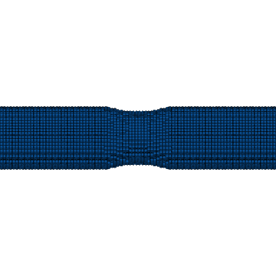<br><a href="docs/results/fibres--single-fibre-tension/summary.json">Single fibre tension</a></td>
<td width="33%" align="center"></td>
<td width="33%" align="center"></td>
</tr>
<tr>
<td width="33%" align="center">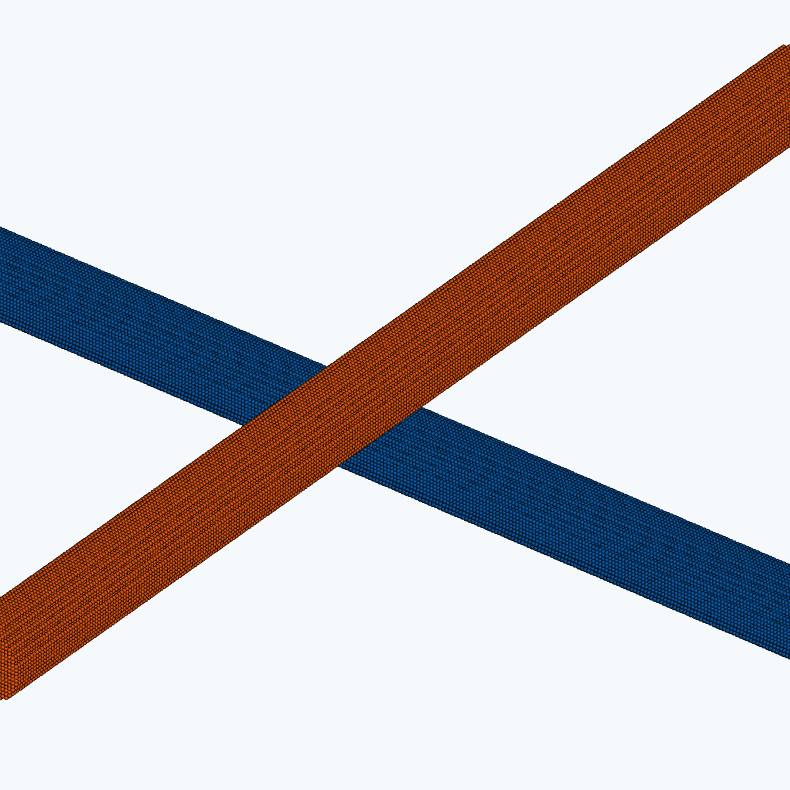<br><a href="docs/results/completed--crossed-fibre-hertz/summary.json">Crossed fibre Hertz contact</a></td>
<td width="33%" align="center"><br><a href="docs/results/completed--crossed-fibre-md/summary.json">Crossed fibre MD contact</a></td>
<td width="33%" align="center"><br><a href="docs/results/completed--crossed-fibre-jkr/summary.json">Crossed fibre JKR contact</a></td>
</tr>
<tr>
<td width="33%" align="center">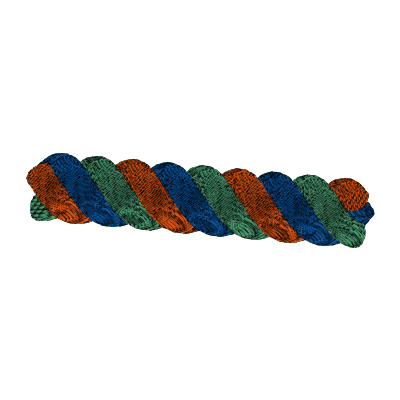<br><a href="docs/results/fibres--three-strand-tension/summary.json">Three-strand tension</a></td>
<td width="33%" align="center">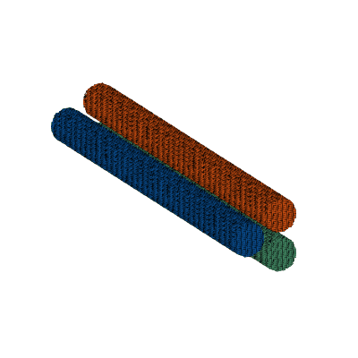<br><a href="docs/results/fibres--three-strand-forming/summary.json">Three-strand forming</a></td>
<td width="33%" align="center">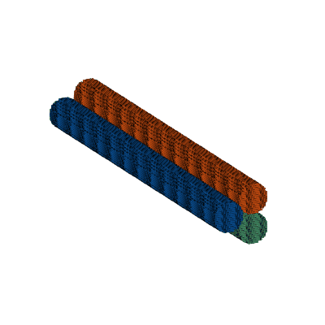<br><a href="docs/results/fibres--dry-three-strand-forming/summary.json">Dry three-strand forming</a></td>
</tr>
</table>

### Woven composites: plate impact

<table width="100%">
<tr>
<td width="33%" align="center">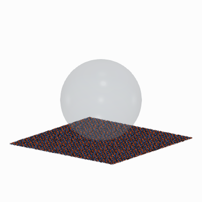<br><a href="docs/results/completed--woven-plate-impact/summary.json">Deep woven plate impact</a></td>
<td width="33%" align="center"></td>
<td width="33%" align="center"></td>
</tr>
</table>

### Woven composites: plain weave

<table width="100%">
<tr>
<td width="33%" align="center">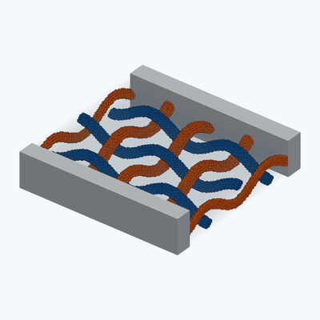<br><a href="docs/results/woven--plain--in-plane-shear/summary.json">0°/90° plain weave · In-plane shear</a></td>
<td width="33%" align="center">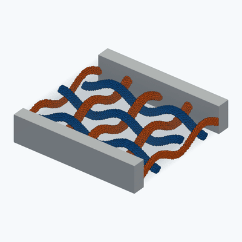<br><a href="docs/results/woven--plain--weft-tension/summary.json">0°/90° plain weave · Transverse in-plane tension</a></td>
<td width="33%" align="center">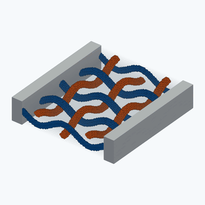<br><a href="docs/results/woven--plain--warp-tension/summary.json">0°/90° plain weave · Warp tension</a></td>
</tr>
</table>

### Woven composites: triaxial weave

<table width="100%">
<tr>
<td width="33%" align="center">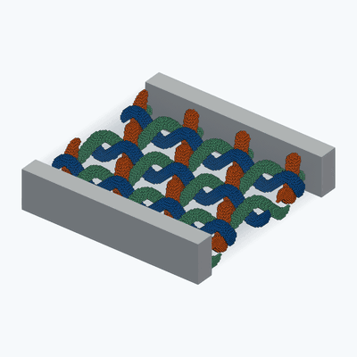<br><a href="docs/results/woven--triaxial--in-plane-shear/summary.json">0°/±60° weave · In-plane shear</a></td>
<td width="33%" align="center">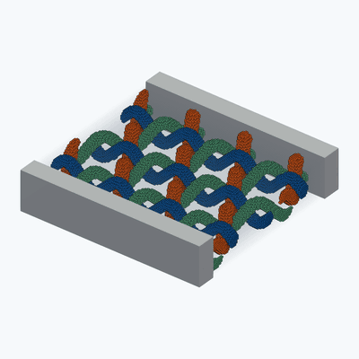<br><a href="docs/results/woven--triaxial--weft-tension/summary.json">0°/±60° weave · Transverse in-plane tension</a></td>
<td width="33%" align="center">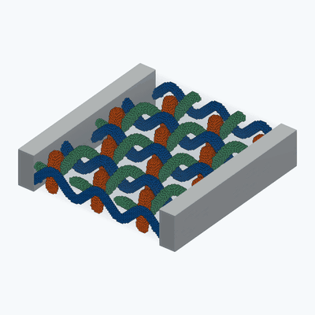<br><a href="docs/results/woven--triaxial--warp-tension/summary.json">0°/±60° weave · Warp tension</a></td>
</tr>
</table>

### Woven composites: twill weave

<table width="100%">
<tr>
<td width="33%" align="center">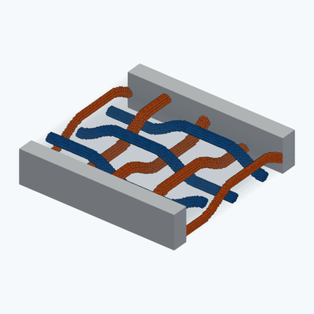<br><a href="docs/results/woven--twill-2x2--in-plane-shear/summary.json">2×2 twill · In-plane shear</a></td>
<td width="33%" align="center"><br><a href="docs/results/woven--twill-2x2--weft-tension/summary.json">2×2 twill · Transverse in-plane tension</a></td>
<td width="33%" align="center">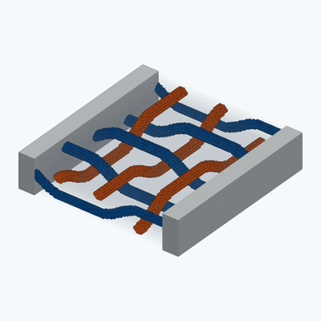<br><a href="docs/results/woven--twill-2x2--warp-tension/summary.json">2×2 twill · Warp tension</a></td>
</tr>
</table>

### Metals

<table width="100%">
<tr>
<td width="33%" align="center"><br><a href="docs/results/completed--jc-necking-refined/summary.json">JC round-bar necking</a></td>
<td width="33%" align="center"><br><a href="docs/results/completed--pressure-panel-jc-damage/summary.json">JC pressure panel damage</a></td>
<td width="33%" align="center"></td>
</tr>
</table>

### Concrete

<table width="100%">
<tr>
<td width="33%" align="center">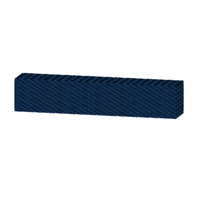<br><a href="docs/HJC_FIXTURE_REFINEMENT.md">HJC beam bending</a></td>
<td width="33%" align="center"><br><a href="docs/results/completed--pressure-panel-hjc-damage/summary.json">HJC legacy-v3 pressure panel damage</a></td>
<td width="33%" align="center"></td>
</tr>
</table>

### Ceramics

<table width="100%">
<tr>
<td width="33%" align="center">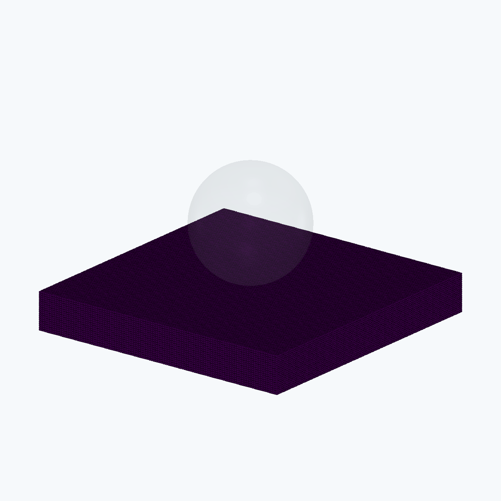<br><a href="docs/results/completed--ceramic-impact-debris/summary.json">JH2 ceramic impact and debris</a></td>
<td width="33%" align="center"><br><a href="docs/results/completed--pressure-panel-jh2-damage/summary.json">JH-2 pressure panel damage</a></td>
<td width="33%" align="center"></td>
</tr>
</table>

### Geotechnical mechanics

<table width="100%">
<tr>
<td width="33%" align="center">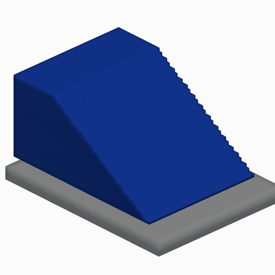<br><a href="docs/MAT173_LANDSLIDE.md">Strength-reduced slope response</a></td>
<td width="33%" align="center"></td>
<td width="33%" align="center"></td>
</tr>
</table>

### Adhesive surface contact

<table width="100%">
<tr>
<td width="33%" align="center">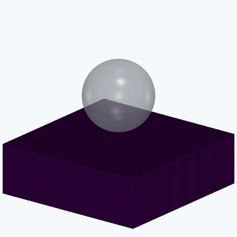<br><a href="docs/results/adhesion-visible--nonadhesive-pull-off/summary.json">Nonadhesive pull-off</a></td>
<td width="33%" align="center">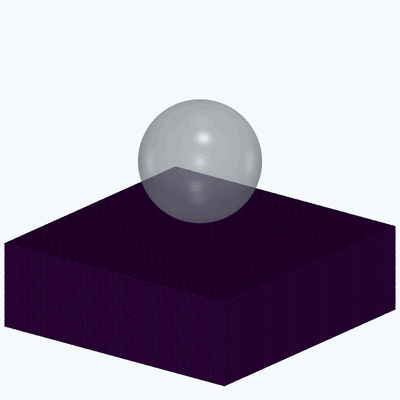<br><a href="docs/results/adhesion-visible--adhesive-pull-off/summary.json">Adhesive pull-off</a></td>
<td width="33%" align="center">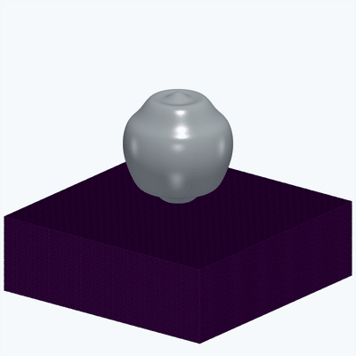<br><a href="docs/results/completed--radial-sinusoidal-pull-off/summary.json">Radial sinusoidal pull-off</a></td>
</tr>
<tr>
<td width="33%" align="center">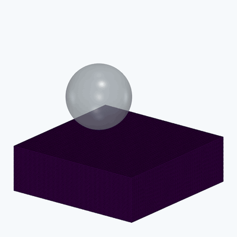<br><a href="docs/results/adhesion--lateral-release/summary.json">Lateral release</a></td>
<td width="33%" align="center">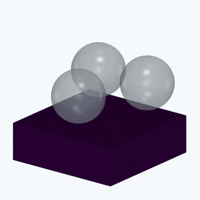<br><a href="docs/results/adhesion--three-sphere-array/summary.json">Three-sphere array</a></td>
<td width="33%" align="center"></td>
</tr>
</table>

### Nonadhesive contact

<table width="100%">
<tr>
<td width="33%" align="center">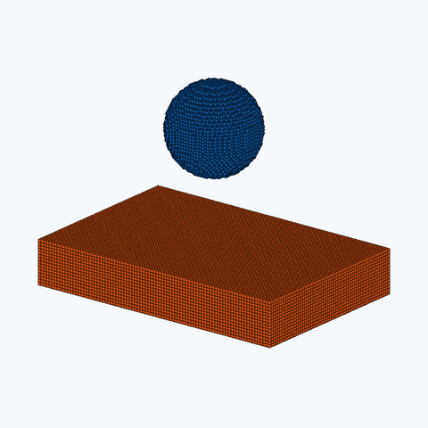<br><a href="docs/results/benchmarks--ball-beam--neo-hookean/summary.json">Ball–beam contact</a></td>
<td width="33%" align="center">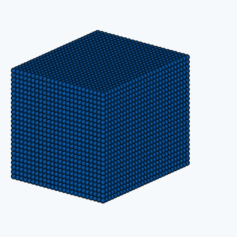<br><a href="docs/results/suite--sliding--neo-hookean/summary.json">Frictional sliding</a></td>
<td width="33%" align="center">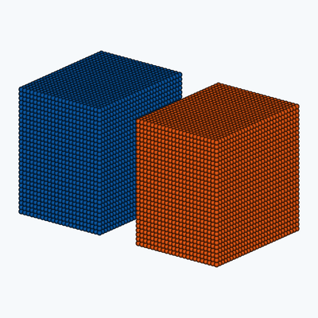<br><a href="docs/results/suite--head-on--neo-hookean/summary.json">Head-on contact</a></td>
</tr>
<tr>
<td width="33%" align="center">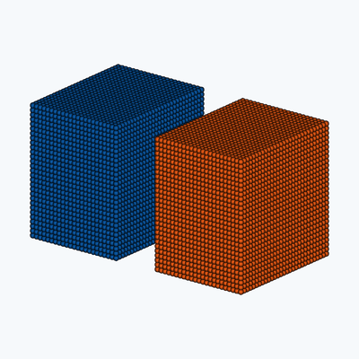<br><a href="docs/results/suite--oblique--neo-hookean/summary.json">Oblique contact</a></td>
<td width="33%" align="center">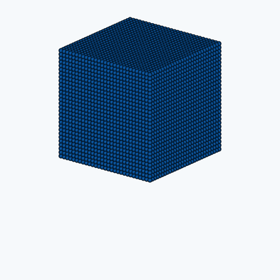<br><a href="docs/results/suite--rebound--neo-hookean/summary.json">Rebound</a></td>
<td width="33%" align="center">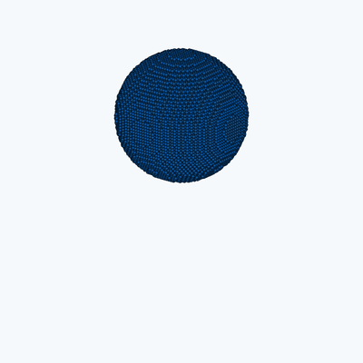<br><a href="docs/results/benchmarks--rubber-ball--neo-hookean/summary.json">Rubber-ball drop</a></td>
</tr>
<tr>
<td width="33%" align="center">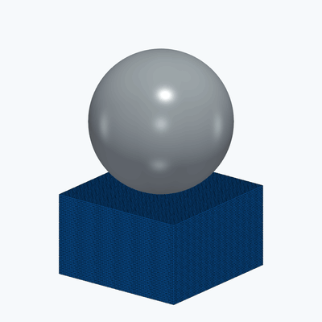<br><a href="docs/results/contact-models--sphere-contact/summary.json">Spherical indentation</a></td>
<td width="33%" align="center"></td>
<td width="33%" align="center"></td>
</tr>
</table>

### Fluid dynamics

<table width="100%">
<tr>
<td width="33%" align="center">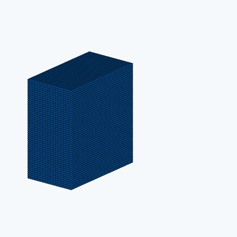<br><a href="docs/results/suite--dam-break--neo-hookean/summary.json">Dam break</a></td>
<td width="33%" align="center">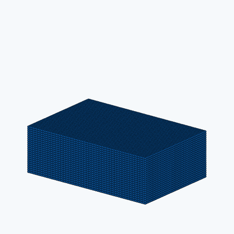<br><a href="docs/results/suite--sloshing--neo-hookean/summary.json">Sloshing</a></td>
<td width="33%" align="center">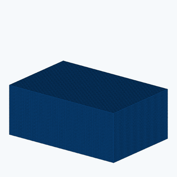<br><a href="docs/results/engineering--unbaffled-tank--neo-hookean/summary.json">Unbaffled tank</a></td>
</tr>
</table>

### Fluid-solid interaction

<table width="100%">
<tr>
<td width="33%" align="center">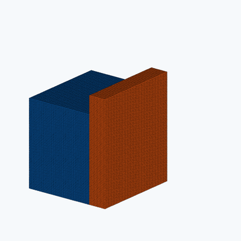<br><a href="docs/results/benchmarks--elastic-gate--neo-hookean/summary.json">Elastic gate</a></td>
<td width="33%" align="center">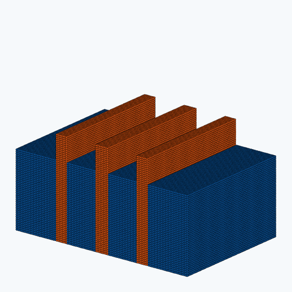<br><a href="docs/results/engineering--baffled-tank--neo-hookean/summary.json">Flexible baffles</a></td>
<td width="33%" align="center">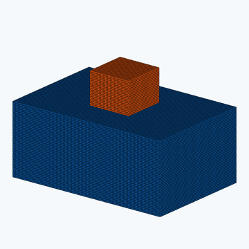<br><a href="docs/results/benchmarks--floating-block--neo-hookean/summary.json">Floating block</a></td>
</tr>
<tr>
<td width="33%" align="center">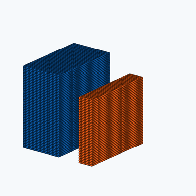<br><a href="docs/results/suite--fsi--neo-hookean/summary.json">Flow past an elastic obstacle</a></td>
<td width="33%" align="center">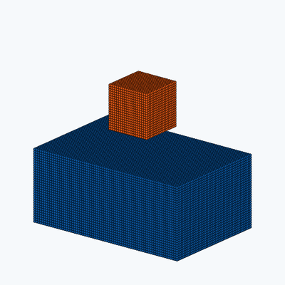<br><a href="docs/results/suite--water-entry--neo-hookean/summary.json">Water entry · reference</a></td>
<td width="33%" align="center">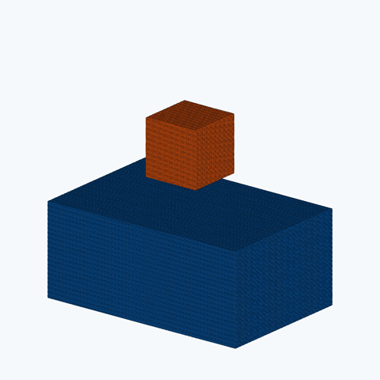<br><a href="docs/results/production--water-entry--neo-hookean/summary.json">Water entry · refined</a></td>
</tr>
</table>

### Structural elasticity

<table width="100%">
<tr>
<td width="33%" align="center">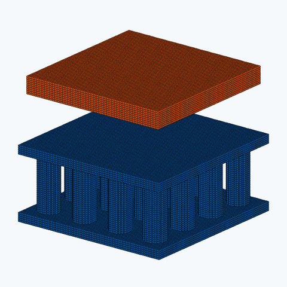<br><a href="docs/results/engineering--cellular-cushion--neo-hookean/summary.json">Cellular cushioning</a></td>
<td width="33%" align="center">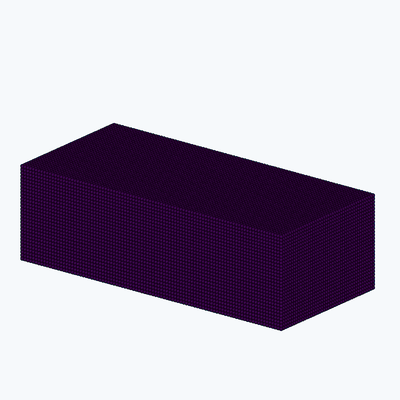<br><a href="docs/results/visible-motion--cantilever--neo-hookean/summary.json">Cyclic bending</a></td>
<td width="33%" align="center">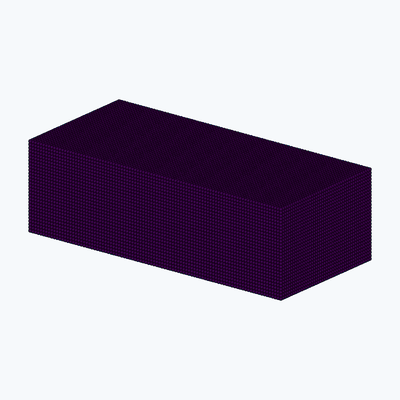<br><a href="docs/results/visible-motion--torsion--neo-hookean/summary.json">Cyclic torsion</a></td>
</tr>
<tr>
<td width="33%" align="center">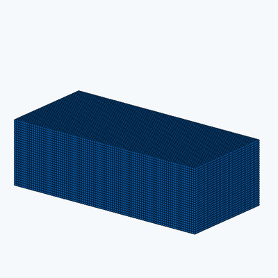<br><a href="docs/results/benchmarks--large-bending--neo-hookean/summary.json">Large bending</a></td>
<td width="33%" align="center">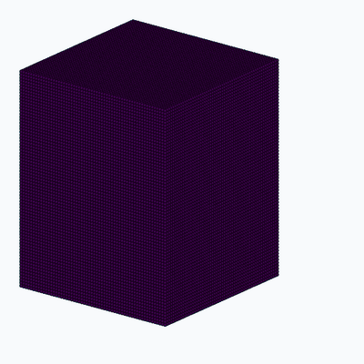<br><a href="docs/results/visible-motion--shear--neo-hookean/summary.json">Large simple shear</a></td>
<td width="33%" align="center">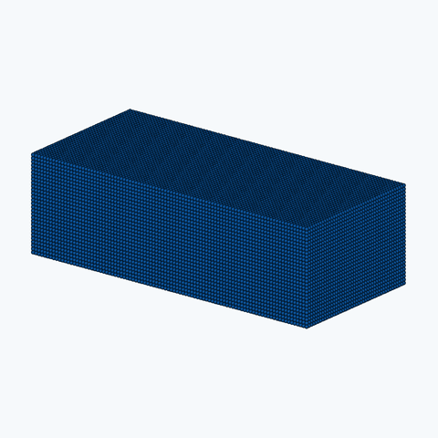<br><a href="docs/results/benchmarks--large-twist--neo-hookean/summary.json">Large twist</a></td>
</tr>
<tr>
<td width="33%" align="center">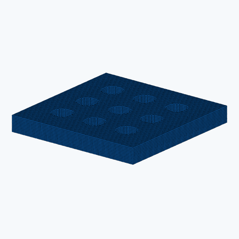<br><a href="docs/results/engineering--perforated-panel--neo-hookean/summary.json">Perforated panel</a></td>
<td width="33%" align="center">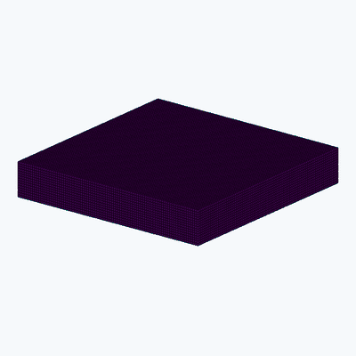<br><a href="docs/results/visible-motion--surface-load--neo-hookean/summary.json">Pressure-loaded panel</a></td>
<td width="33%" align="center"></td>
</tr>
</table>

### JAX design

<table width="100%">
<tr>
<td width="33%" align="center">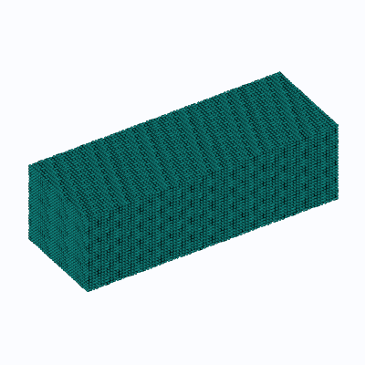<br><a href="docs/STRUCTURAL_DESIGN.md">Uniform reference · y load</a></td>
<td width="33%" align="center">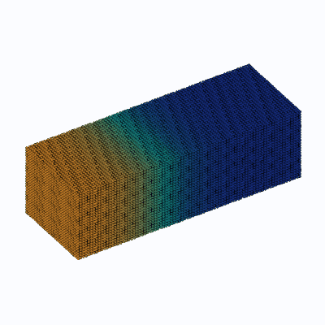<br><a href="docs/STRUCTURAL_DESIGN.md">Optimized layout · y load</a></td>
<td width="33%" align="center"></td>
</tr>
<tr>
<td width="33%" align="center">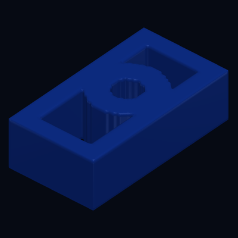<br><a href="docs/COMBINED_BRACKET_DESIGN.md">Perforated bracket · initial</a></td>
<td width="33%" align="center">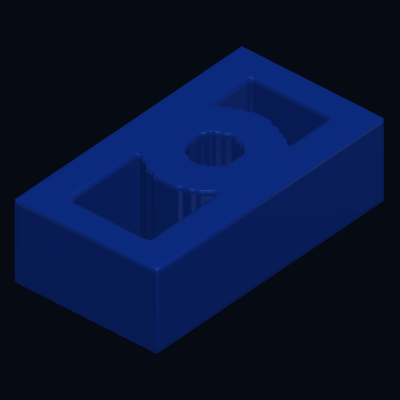<br><a href="docs/COMBINED_BRACKET_DESIGN.md">Perforated bracket · optimized</a></td>
<td width="33%" align="center"></td>
</tr>

<tr>
<td width="33%" align="center"><br><a href="docs/JAX_ORTHOTROPIC_INVERSE.md">Orthotropic inverse · holdout</a></td>
<td width="33%" align="center"></td>
<td width="33%" align="center"></td>
</tr>
</table>

<!-- END EXAMPLE GIFS -->

## Installation

Python 3.12 or later:

```bash
git clone https://github.com/lililii124/jax-mpm.git
cd jax-mpm
python -m venv .venv
```

Activate with `source .venv/bin/activate` on Linux/macOS or
`.venv\Scripts\Activate.ps1` on Windows, then install:

```bash
python -m pip install -e ".[test]"
```

On Windows, `setup.ps1` creates `.venv312`. Its `-PythonPath` and `-JaxSource`
options select an interpreter and an optional local JAX source archive.

## Examples

```bash
python -m examples.suite --list
python -m examples.suite --case oblique --gif
python -m examples.suite --case fsi --gif
python -m examples.suite --case elastic-gate --grid 48 --ppc 3 --gif
python -m examples.suite --case perforated-panel --grid 48 --ppc 3 --gif
python -m examples.suite --case cellular-cushion --grid 48 --ppc 3 --gif
python -m examples.material_paths --model all
python -m examples.pressure_pulse_panels --model jc --grid 128 --ppc 2
python -m examples.adhesive_contact --case sphere-contact --grid 48 --ppc 3 --gif
python -m examples.material_engineering --case jc-tension --grid 80 --frames 60 --gif
python -m examples.material_engineering --case concrete-bending --frames 40 --gif
python -m examples.material_engineering --case ceramic-indentation --frames 40 --gif
python -m examples.woven_composite --architecture plain --loading warp-tension --resume
```

`--grid` and `--ppc` control spatial resolution; the spatial suite also accepts
`--dt-factor` to reduce the time step.
`--frames` changes output frequency while preserving the physical duration.
For `examples.suite`, `--case all` runs the scenarios with their default materials.
Completed runs and animations are included in the [results](docs/RESULTS.md)
and [gallery](docs/GALLERY.md).

<table width="100%">
<tr>
<td width="50%" align="center">Elastic dynamics</td>
<td width="50%" align="center">Longitudinal wave, cantilever vibration, torsional release, large bending/twist</td>
</tr>
<tr>
<td width="50%" align="center">Prescribed loading</td>
<td width="50%" align="center">Simple shear, platen compression, pressure-loaded clamped panel</td>
</tr>
<tr>
<td width="50%" align="center">Contact</td>
<td width="50%" align="center">Head-on collision, oblique collision, frictional sliding, rebound, rubber-ball drop, ball–beam contact</td>
</tr>
<tr>
<td width="50%" align="center">Spherical contact</td>
<td width="50%" align="center">Prescribed rigid sphere indentation; Hertz and JKR pressure footprints</td>
</tr>
<tr>
<td width="50%" align="center">Fluids</td>
<td width="50%" align="center">Dam break, sloshing</td>
</tr>
<tr>
<td width="50%" align="center">Fluid–solid interaction</td>
<td width="50%" align="center">Clamped obstacle, elastic-block water entry, top-clamped gate, floating block</td>
</tr>
<tr>
<td width="50%" align="center">Engineering structures</td>
<td width="50%" align="center">Perforated panel under a pressure pulse, cellular elastomer cushion under a falling mass</td>
</tr>
<tr>
<td width="50%" align="center">Accelerated tanks</td>
<td width="50%" align="center">Harmonic base excitation, with and without perforated flexible baffles</td>
</tr>
<tr>
<td width="50%" align="center">Material points</td>
<td width="50%" align="center">Compression/unload, hydrostatic compression, shear reversal, confined shear</td>
</tr>
<tr>
<td width="50%" align="center">Material engineering</td>
<td width="50%" align="center">JC round-bar tension to failure, concrete beam bending, ceramic indentation</td>
</tr>
<tr>
<td width="50%" align="center">Woven composites</td>
<td width="50%" align="center">Plain, triaxial and 2×2 twill under in-plane tension/shear and transverse compression/bending</td>
</tr>
</table>

The [woven composite examples](docs/WOVEN_COMPOSITES.md) use bonded elastic
yarns and matrix with explicit local material axes. They write numerical output
by default; use the separate ParaView command in the guide to show yarn families.

Each spatial run saves particle trajectories and final states as NPZ, diagnostics
and observables as CSV, and a JSON definition/result summary. Rendering adds
ParaView images and animations.
`--gif` adds an animation; `--no-render` skips rendering. ParaView renders
every particle, with a fixed camera and no axes or annotations. Compressed
VTK files and a ParaView state accompany the images. Install ParaView and put
`pvpython` on PATH, or set `PARAVIEW_PYTHON` to its executable. See
[the rendering guide](docs/RENDERING.md).

Long runs save a checkpoint after every output frame:

```bash
python -m examples.suite --case water-entry --grid 72 --ppc 3 --frames 60 --no-render --resume --output outputs/production
python -m mpm_jax.visualization outputs/production/water-entry/neo-hookean --gif
```

Repeat the first command to resume an interrupted run. `status.json` records
progress; `summary.json` is written after the full duration completes.
Output histories use file-backed arrays so memory use does not grow with the
number of saved frames.

The original 2D examples and material-gradient check remain available:

```bash
python -m mpm_jax --scene elastic --gif
python -m mpm_jax --scene dam-break --dim 3 --gif
python -m examples.gradient
```

See [the example guide](docs/EXAMPLES.md) for geometry, boundary conditions,
observables, and refinement commands. The [finite-motion guide](docs/VISIBLE_MOTION.md)
gives the loading cycles and shear-wave comparisons shown above.
The [material engineering guide](docs/MATERIAL_ENGINEERING.md)
describes the round bar, concrete beam and ceramic tile, their material sources,
and the interpretation of grip forces, section forces and damage.

## Materials

<table width="100%">
<tr>
<td width="50%" align="center">Linear elasticity</td>
<td width="50%" align="center">Isotropic, orthotropic, transverse isotropic; rotated material axes</td>
</tr>
<tr>
<td width="50%" align="center">Hyperelasticity</td>
<td width="50%" align="center">Compressible Neo-Hookean, selected Blatz–Ko rubber branch</td>
</tr>
<tr>
<td width="50%" align="center">Metal plasticity</td>
<td width="50%" align="center">Mixed/isotropic bilinear J2, prescribed-temperature plasticity, Johnson–Cook, selected Steinberg–Guinan branch</td>
</tr>
<tr>
<td width="50%" align="center">Brittle materials</td>
<td width="50%" align="center">JH-2, HJC, three-surface RHT with p-alpha compaction</td>
</tr>
<tr>
<td width="50%" align="center">Fluid</td>
<td width="50%" align="center">Compressible inviscid volumetric law</td>
</tr>
<tr>
<td width="50%" align="center">Woven composite</td>
<td width="50%" align="center">Orthotropic Saint Venant–Kirchhoff yarns in a Neo-Hookean matrix; fully bonded interface</td>
</tr>
</table>

The incremental models use three-dimensional stress/history tensors. Defaults
are demonstration parameters. Model conventions, source scopes, and omitted
branches are recorded in [docs/MATERIALS.md](docs/MATERIALS.md).

## Python API

```python
from mpm_jax import Config, advance, block, fixed_box, neo_hookean, validate_state

config = Config(
    dim=3, n_grid=48, dt=2e-4, material="neo-hookean",
    gravity=(0., 0., 0.), boundary_cells=0,
    boundaries=(fixed_box((0., 0., 0.), (.2, 1., 1.)),),
)
material = neo_hookean(young=2e4, poisson=.2)
state = block(config, (.15, .4, .35), (.8, .6, .65), density=1000.)
state = advance(state, material, config, steps=1000)
validate_state(state, config)
```

`PlaneWall` supplies unilateral slip/friction walls, including constant wall
velocity. `VelocityBox` supplies prescribed velocity components in a physical
coordinate region with an activation interval. `fixed_box` is its zero-velocity
form. `MovingVelocityBox` translates this region with the integrated prescribed
velocity and supports a half-cosine startup ramp.
`step(..., force=...)` accepts an `(N, dim)` array of particle forces in N.
`coupled_step` advances two bodies on separate grids with balanced normal and
Coulomb impulses. See `examples/scenarios.py` for complete setups.

`RigidSphereBoundary` adds a prescribed frictionless sphere. Hertz and JKR laws
are available in `mpm_jax.contact_laws`, with stable-branch derivatives and
conservative pressure-footprint assignment. The JKR footprint prescribes a load;
it does not solve self-consistent three-dimensional adhesive contact.
See [spherical contact](docs/CONTACT.md) for equations and examples.

## Numerical scope

- Dense background grid on `[0, L]^dim`; 2D particle volumes assume unit thickness.
- Stress is evaluated before P2G; deformation/history are updated after G2P.
- Incremental constitutive integration uses a polar rotation and logarithmic
  strain increment. Linear elasticity assumes small strain and small rotation.
- The fluid is compressible and inviscid. The interface treatment is nonadhesive
  normal contact; there is no incompressible pressure solve, cavitation,
  turbulence model, or thermal conduction.
- Failed particles retain mass. The default keeps grid participation; optional
  [ballistic failure](docs/FAILURE.md) removes their load-carrying capacity and
  advances them as noncontacting debris. There is no crack-surface reconstruction,
  fragment recontact, or fracture-energy regularization.
- Elastic material gradients are tested in 2D and 3D. Plasticity/damage return
  maps and their adaptive loops are not advertised as differentiable.
- Invalid deformation, missing grid support, nonfinite states, and failed
  constitutive convergence are reported. Time-step stability and spatial
  convergence remain problem dependent.

## Verification

```bash
python -m pytest -q
```

Tests cover transfers, conservation, elasticity, constitutive limits, boundary
conditions, contact, gradients, and fifteen supplied material-point reference traces.
[VALIDATION.md](VALIDATION.md) records quantitative checks;
[the run catalogue](docs/RESULTS.md) lists completed cases.
GPU execution has not been validated.

## License

[AGPL-3.0-or-later](LICENSE). The earlier solver and Taichi-derived transfer code
retain their Apache-2.0 attribution in [NOTICE](NOTICE) and `third_party/`.
Sources are listed in [REFERENCES.md](REFERENCES.md).
