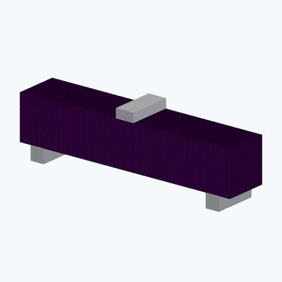
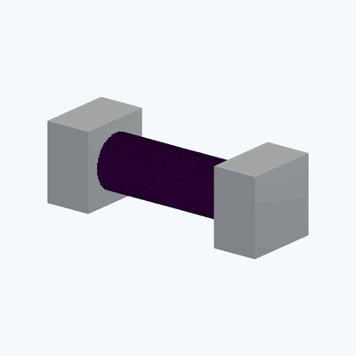
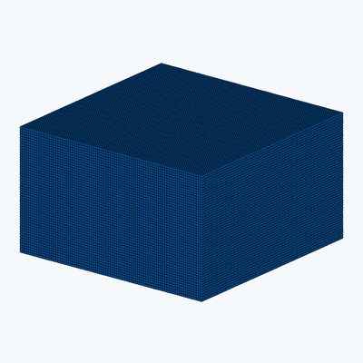

# jax-mpm

Two- and three-dimensional material point mechanics in JAX: quadratic B-splines,
APIC transfers, explicit dynamics, constitutive history, and two-body contact.

<!-- BEGIN EXAMPLE GIFS -->

[Gallery](docs/GALLERY.md) · [Examples](docs/EXAMPLES.md) · [Verification](VALIDATION.md)

### Material engineering

| | | |
|---|---|---|
| <br>[HJC bending with symmetry constraints](docs/results/material-engineering--concrete-bending-symmetric--hjc/summary.json) | <br>[JC round-bar tension](docs/results/material-engineering--jc-tension--johnson-cook/summary.json) | <br>[JH2 ceramic impact and debris](docs/results/completed--ceramic-impact-debris/summary.json) |

### Adhesion comparison

| | |
|---|---|
| <br>[Nonadhesive pull-off](docs/results/adhesion-visible--nonadhesive-pull-off/summary.json) | <br>[Adhesive pull-off](docs/results/adhesion-visible--adhesive-pull-off/summary.json) |

### Woven composites

| | | |
|---|---|---|
| <br>[0°/90° plain weave · Warp tension](docs/results/woven--plain--warp-tension/summary.json) | <br>[0°/±60° weave · Warp tension](docs/results/woven--triaxial--warp-tension/summary.json) | <br>[2×2 twill · Warp tension](docs/results/woven--twill-2x2--warp-tension/summary.json) |
| <br>[0°/90° plain weave · Transverse in-plane tension](docs/results/woven--plain--weft-tension/summary.json) | <br>[0°/±60° weave · Transverse in-plane tension](docs/results/woven--triaxial--weft-tension/summary.json) | <br>[2×2 twill · Transverse in-plane tension](docs/results/woven--twill-2x2--weft-tension/summary.json) |
| <br>[0°/90° plain weave · In-plane shear](docs/results/woven--plain--in-plane-shear/summary.json) | <br>[0°/±60° weave · In-plane shear](docs/results/woven--triaxial--in-plane-shear/summary.json) | <br>[2×2 twill · In-plane shear](docs/results/woven--twill-2x2--in-plane-shear/summary.json) |

### Structures and tanks

| | | |
|---|---|---|
| <br>[Cellular cushioning](docs/results/engineering--cellular-cushion--neo-hookean/summary.json) | <br>[Flexible baffles](docs/results/engineering--baffled-tank--neo-hookean/summary.json) | <br>[Large bending](docs/results/benchmarks--large-bending--neo-hookean/summary.json) |
| <br>[Large twist](docs/results/benchmarks--large-twist--neo-hookean/summary.json) | <br>[Perforated panel](docs/results/engineering--perforated-panel--neo-hookean/summary.json) | <br>[Unbaffled tank](docs/results/engineering--unbaffled-tank--neo-hookean/summary.json) |

### Dynamics and contact

| | | |
|---|---|---|
| <br>[Ball–beam contact](docs/results/benchmarks--ball-beam--neo-hookean/summary.json) | <br>[Clamped woven plate impact](docs/results/completed--woven-plate-impact/summary.json) | <br>[Crossed fibre Hertz contact](docs/results/completed--crossed-fibre-hertz/summary.json) |
| <br>[Frictional sliding](docs/results/suite--sliding--neo-hookean/summary.json) | <br>[Head-on contact](docs/results/suite--head-on--neo-hookean/summary.json) | <br>[JKR pressure footprint](docs/results/contact-models--jkr-footprint/summary.json) |
| <br>[Lateral release](docs/results/adhesion--lateral-release/summary.json) | <br>[Oblique contact](docs/results/suite--oblique--neo-hookean/summary.json) | <br>[Rebound](docs/results/suite--rebound--neo-hookean/summary.json) |
| <br>[Rubber-ball drop](docs/results/benchmarks--rubber-ball--neo-hookean/summary.json) | <br>[Spherical indentation](docs/results/contact-models--sphere-contact/summary.json) | <br>[Three-sphere array](docs/results/adhesion--three-sphere-array/summary.json) |

### Fluids and fluid–solid interaction

| | | |
|---|---|---|
| <br>[Dam break](docs/results/suite--dam-break--neo-hookean/summary.json) | <br>[Elastic gate](docs/results/benchmarks--elastic-gate--neo-hookean/summary.json) | <br>[Floating block](docs/results/benchmarks--floating-block--neo-hookean/summary.json) |
| <br>[Flow past an elastic obstacle](docs/results/suite--fsi--neo-hookean/summary.json) | <br>[Sloshing](docs/results/suite--sloshing--neo-hookean/summary.json) | <br>[Water entry · reference](docs/results/suite--water-entry--neo-hookean/summary.json) |
| <br>[Water entry · refined](docs/results/production--water-entry--neo-hookean/summary.json) |  |  |

### Elasticity and prescribed loading

| | | |
|---|---|---|
| <br>[Cyclic bending](docs/results/visible-motion--cantilever--neo-hookean/summary.json) | <br>[Cyclic torsion](docs/results/visible-motion--torsion--neo-hookean/summary.json) | <br>[Large simple shear](docs/results/visible-motion--shear--neo-hookean/summary.json) |
| <br>[Pressure-loaded panel](docs/results/visible-motion--surface-load--neo-hookean/summary.json) |  |  |

<!-- END EXAMPLE GIFS -->

## Installation

Python 3.12 or later:

```bash
git clone https://github.com/lililii124/jax-mpm.git
cd jax-mpm
python -m venv .venv
```

Activate with `source .venv/bin/activate` on Linux/macOS or
`.venv\Scripts\Activate.ps1` on Windows, then install:

```bash
python -m pip install -e ".[test]"
```

On Windows, `setup.ps1` creates `.venv312`. Its `-PythonPath` and `-JaxSource`
options select an interpreter and an optional local JAX source archive.

## Examples

```bash
python -m examples.suite --list
python -m examples.suite --case oblique --gif
python -m examples.suite --case fsi --gif
python -m examples.suite --case elastic-gate --grid 48 --ppc 3 --gif
python -m examples.suite --case perforated-panel --grid 48 --ppc 3 --gif
python -m examples.suite --case cellular-cushion --grid 48 --ppc 3 --gif
python -m examples.material_paths --model all
python -m examples.adhesive_contact --case sphere-contact --grid 48 --ppc 3 --gif
python -m examples.adhesive_contact --case jkr-footprint --grid 48 --ppc 3 --gif
python -m examples.material_engineering --case jc-tension --grid 80 --frames 60 --gif
python -m examples.material_engineering --case concrete-bending --frames 40 --gif
python -m examples.material_engineering --case ceramic-indentation --frames 40 --gif
python -m examples.woven_composite --architecture plain --loading warp-tension --resume
```

`--grid` and `--ppc` control spatial resolution; the spatial suite also accepts
`--dt-factor` to reduce the time step.
`--frames` changes output frequency while preserving the physical duration.
For `examples.suite`, `--case all` runs the scenarios with their default materials.
Completed runs and animations are included in the [results](docs/RESULTS.md)
and [gallery](docs/GALLERY.md).

| Group | Cases |
|---|---|
| Elastic dynamics | Longitudinal wave, cantilever vibration, torsional release, large bending/twist |
| Prescribed loading | Simple shear, platen compression, pressure-loaded clamped panel |
| Contact | Head-on collision, oblique collision, frictional sliding, rebound, rubber-ball drop, ball–beam contact |
| Spherical contact | Prescribed rigid sphere indentation; Hertz and JKR pressure footprints |
| Fluids | Dam break, sloshing |
| Fluid–solid interaction | Clamped obstacle, elastic-block water entry, top-clamped gate, floating block |
| Engineering structures | Perforated panel under a pressure pulse, cellular elastomer cushion under a falling mass |
| Accelerated tanks | Harmonic base excitation, with and without perforated flexible baffles |
| Material points | Compression/unload, hydrostatic compression, shear reversal, confined shear |
| Material engineering | JC round-bar tension to failure, concrete beam bending, ceramic indentation |
| Woven composites | Plain, triaxial and 2×2 twill under in-plane tension/shear and transverse compression/bending |

The [woven composite examples](docs/WOVEN_COMPOSITES.md) use bonded elastic
yarns and matrix with explicit local material axes. They write numerical output
by default; use the separate ParaView command in the guide to show yarn families.

Each spatial run saves particle trajectories and final states as NPZ, diagnostics
and observables as CSV, and a JSON definition/result summary. Rendering adds
ParaView images and animations.
`--gif` adds an animation; `--no-render` skips rendering. ParaView renders
every particle, with a fixed camera and no axes or annotations. Compressed
VTK files and a ParaView state accompany the images. Install ParaView and put
`pvpython` on PATH, or set `PARAVIEW_PYTHON` to its executable. See
[the rendering guide](docs/RENDERING.md).

Long runs save a checkpoint after every output frame:

```bash
python -m examples.suite --case water-entry --grid 72 --ppc 3 --frames 60 --no-render --resume --output outputs/production
python -m mpm_jax.visualization outputs/production/water-entry/neo-hookean --gif
```

Repeat the first command to resume an interrupted run. `status.json` records
progress; `summary.json` is written after the full duration completes.
Output histories use file-backed arrays so memory use does not grow with the
number of saved frames.

The original 2D examples and material-gradient check remain available:

```bash
python -m mpm_jax --scene elastic --gif
python -m mpm_jax --scene dam-break --dim 3 --gif
python -m examples.gradient
```

See [the example guide](docs/EXAMPLES.md) for geometry, boundary conditions,
observables, and refinement commands. The [finite-motion guide](docs/VISIBLE_MOTION.md)
gives the loading cycles and shear-wave comparisons shown above.
The [material engineering guide](docs/MATERIAL_ENGINEERING.md)
describes the round bar, concrete beam and ceramic tile, their material sources,
and the interpretation of grip forces, section forces and damage.

## Materials

| Family | Implementations |
|---|---|
| Linear elasticity | Isotropic, orthotropic, transverse isotropic; rotated material axes |
| Hyperelasticity | Compressible Neo-Hookean, selected Blatz–Ko rubber branch |
| Metal plasticity | Mixed/isotropic bilinear J2, prescribed-temperature plasticity, Johnson–Cook, selected Steinberg–Guinan branch |
| Brittle materials | JH-2, HJC, three-surface RHT with p-alpha compaction |
| Fluid | Compressible inviscid volumetric law |
| Woven composite | Orthotropic Saint Venant–Kirchhoff yarns in a Neo-Hookean matrix; fully bonded interface |

The incremental models use three-dimensional stress/history tensors. Defaults
are demonstration parameters. Model conventions, source scopes, and omitted
branches are recorded in [docs/MATERIALS.md](docs/MATERIALS.md).

## Python API

```python
from mpm_jax import Config, advance, block, fixed_box, neo_hookean, validate_state

config = Config(
    dim=3, n_grid=48, dt=2e-4, material="neo-hookean",
    gravity=(0., 0., 0.), boundary_cells=0,
    boundaries=(fixed_box((0., 0., 0.), (.2, 1., 1.)),),
)
material = neo_hookean(young=2e4, poisson=.2)
state = block(config, (.15, .4, .35), (.8, .6, .65), density=1000.)
state = advance(state, material, config, steps=1000)
validate_state(state, config)
```

`PlaneWall` supplies unilateral slip/friction walls, including constant wall
velocity. `VelocityBox` supplies prescribed velocity components in a physical
coordinate region with an activation interval. `fixed_box` is its zero-velocity
form. `MovingVelocityBox` translates this region with the integrated prescribed
velocity and supports a half-cosine startup ramp.
`step(..., force=...)` accepts an `(N, dim)` array of particle forces in N.
`coupled_step` advances two bodies on separate grids with balanced normal and
Coulomb impulses. See `examples/scenarios.py` for complete setups.

`RigidSphereBoundary` adds a prescribed frictionless sphere. Hertz and JKR laws
are available in `mpm_jax.contact_laws`, with stable-branch derivatives and
conservative pressure-footprint assignment. The JKR footprint prescribes a load;
it does not solve self-consistent three-dimensional adhesive contact.
See [spherical contact](docs/CONTACT.md) for equations and examples.

## Numerical scope

- Dense background grid on `[0, L]^dim`; 2D particle volumes assume unit thickness.
- Stress is evaluated before P2G; deformation/history are updated after G2P.
- Incremental constitutive integration uses a polar rotation and logarithmic
  strain increment. Linear elasticity assumes small strain and small rotation.
- The fluid is compressible and inviscid. The interface treatment is nonadhesive
  normal contact; there is no incompressible pressure solve, cavitation,
  turbulence model, or thermal conduction.
- Failed particles retain mass. The default keeps grid participation; optional
  [ballistic failure](docs/FAILURE.md) removes their load-carrying capacity and
  advances them as noncontacting debris. There is no crack-surface reconstruction,
  fragment recontact, or fracture-energy regularization.
- Elastic material gradients are tested in 2D and 3D. Plasticity/damage return
  maps and their adaptive loops are not advertised as differentiable.
- Invalid deformation, missing grid support, nonfinite states, and failed
  constitutive convergence are reported. Time-step stability and spatial
  convergence remain problem dependent.

## Verification

```bash
python -m pytest -q
```

Tests cover transfers, conservation, elasticity, constitutive limits, boundary
conditions, contact, gradients, and fifteen supplied material-point reference traces.
[VALIDATION.md](VALIDATION.md) records quantitative checks;
[the run catalogue](docs/RESULTS.md) lists completed cases.
GPU execution has not been validated.

## License

[AGPL-3.0-or-later](LICENSE). The earlier solver and Taichi-derived transfer code
retain their Apache-2.0 attribution in [NOTICE](NOTICE) and `third_party/`.
Sources are listed in [REFERENCES.md](REFERENCES.md).

### Numerical stage preview

Historical metal impact model: numerical stage preview only. 17 actual saved states from 0 to 266.667 ns. Phase/EOS extrapolation (temperature reaches about 34,500 K); NOT validated 5 km/s impact physics or a completed protocol. No numerical solver rerun. Original-resolution GIF; uniform display size only.


[Stage evidence](docs/stages/metal-impact-f16/README.md)
