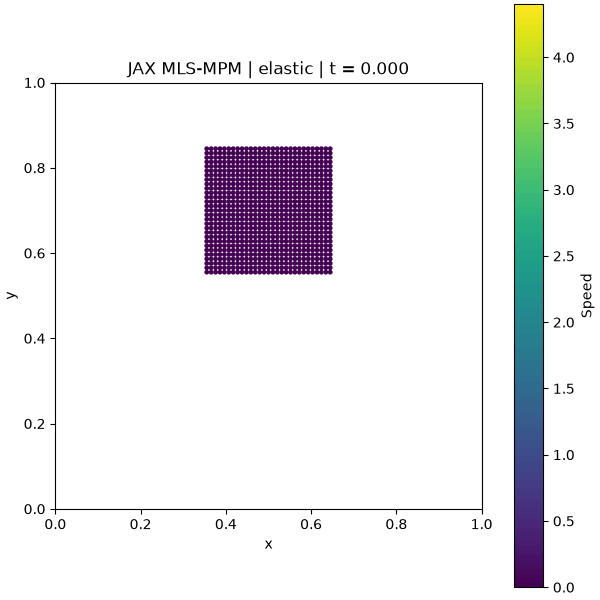
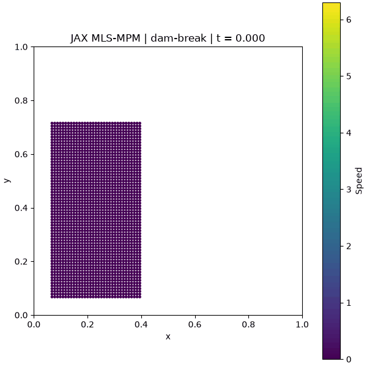

# jax-mpm

A differentiable 2D material point method solver in JAX. The solver uses
quadratic B-splines, APIC transfers, and explicit time integration for
Neo-Hookean solids and compressible inviscid fluids.

| Elastic block | Dam break |
|---|---|
|  |  |

## Installation

Python 3.12 or later:

```bash
git clone https://github.com/lililii124/jax-mpm.git
cd jax-mpm
python -m venv .venv
```

Activate with `source .venv/bin/activate` on Linux/macOS or
`.venv\Scripts\Activate.ps1` on Windows, then install:

```bash
python -m pip install -e ".[test]"
```

On Windows, `setup.ps1` creates a separate `.venv312` environment.
Use `-PythonPath` to select an interpreter and `-JaxSource` to install a local
JAX source archive.

## Examples

```bash
python -m mpm_jax --scene elastic --gif
python -m mpm_jax --scene dam-break --gif
python -m examples.gradient
```

Both simulations run 4,000 steps with a 48 × 48 grid and save results under
`outputs/`. Each directory contains an animation, a final image, NPZ particle
data, a diagnostics CSV, and a JSON run summary.

`--grid`, `--dt`, `--frames`, and `--substeps` control resolution and duration.
`--ppc` sets particles per cell per axis; `--x64` enables double precision.
See `python -m mpm_jax --help` for material parameters and output options.

## Python API

```python
from mpm_jax import Config, advance, block, elastic, validate_state

config = Config(n_grid=48, dt=2e-4)
state = block(config, lower=(0.35, 0.55), upper=(0.65, 0.85), density=1000)
material = elastic(young=2e4, poisson=0.2)

state = advance(state, material, config, steps=1000)
validate_state(state, config)
```

For fluids, use `Config(material="fluid")` with `fluid(bulk=2e5)`.
A simulation uses one material. `State` is a JAX PyTree; `advance` uses
`lax.scan` and supports differentiation with respect to material parameters.
See [examples/gradient.py](examples/gradient.py) for a finite-difference check.

## Formulation

The domain is `[0, L]²`, with `n_grid` cells per side. Particle volumes are
reference areas at unit thickness. Stress is evaluated before P2G;
positions and deformation gradients are updated after G2P.

With `J = det(F)`, the Kirchhoff stresses are:

- Solid, plane strain: `τ = μ(FFᵀ − I) + λ ln(J)I`.
- Fluid: `τ = KJ(J − 1)I`, from `W(J) = K(J − 1)²/2`.

The fluid stores volumetric deformation and discards shear history. Boundary
nodes remove outward normal velocity and retain tangential velocity.
Inverted deformation, nonfinite values, and incomplete grid support mark the
state invalid; `validate_state` raises an error outside JIT.

The current implementation uses a dense grid, a single material, and free-slip
walls. The fluid is compressible. It has no plasticity, damage, or frictional
contact model. Contact and grid-cell changes make gradients piecewise smooth.
Explicit time steps must resolve both elastic waves and particle motion.

## Tests

```bash
python -m pytest -q
```

Tests cover transfer consistency, mass and momentum conservation, constitutive
stress, free fall, boundary conditions, impact, and material gradients.
See [VALIDATION.md](VALIDATION.md) for the reference runs.

## References and license

The transfer scheme follows Taichi's MLS-MPM example. JAX solver organization
was informed by DiffMPM. Details are in [REFERENCES.md](REFERENCES.md).

[Apache-2.0](LICENSE). Third-party attribution is in [NOTICE](NOTICE).
