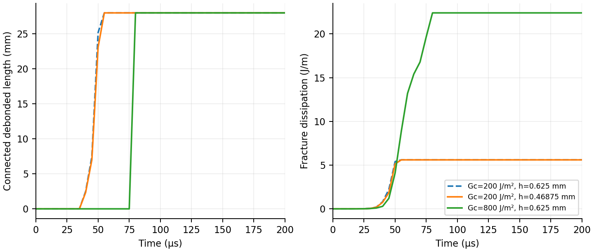

# Energy-controlled cohesive fracture

This example replaces prescribed crack-tip speed with cohesive interface
failure. The bulk material uses neo-Hookean elasticity. Separate velocity
fields carry the two sides; equal and opposite cohesive forces couple them
until their separation consumes the specified fracture energy.

The potential fracture plane is specified in advance. Failure times and
openings are computed. Crack turning and new fracture-plane insertion remain
separate development tasks.

<table width="100%">
<tr>
<td width="33%" align="center"><br>Gc = 200 J/m² · coarse</td>
<td width="33%" align="center"><br>Gc = 200 J/m² · refined</td>
<td width="33%" align="center"><br>Gc = 800 J/m²</td>
</tr>
</table>

All three ParaView animations cover 0–200 µs in 41 frames, use computed
displacements at unit scale, and share a 0–18 MPa normal-stress colour range.

## Constitutive law

For stiffness `K`, strength `s` and fracture energy `Gc`, peak opening is
`d0 = s/K` and complete separation is `df = 2 Gc/s`. The traction rises
linearly and then softens linearly to zero. The maximum effective opening
controls irreversible damage; unloading follows the current secant stiffness.
This is the energy relation used by the
[triangular traction law](https://osupdocs.forestry.oregonstate.edu/index.php?title=Triangular_Traction_Law).

Normal opening and tangential separation use identical parameters and a
single effective opening. Independent mode-I/mode-II parameters are not
offered by this implementation: effective-displacement coupling requires
restrictions on their relative shapes, as discussed in the
[coupled traction-law documentation](https://osupdocs.forestry.oregonstate.edu/index.php/Coupled_Traction_Law).
Compression retains an elastic normal penalty after tensile failure.

The initial geometric crack has no tensile or shear bonds. Its damage
history starts at zero; it contributes no fictitious initial fracture energy.
Physical cohesive dissipation and numerical transfer losses are separate.

## Discrete energy balance

The two face markers have separate positions. Each face uses the same
occupied-node weights to interpolate velocity and scatter force. Consequently,
the work on the grid equals the work on the interface, and interface forces
sum to zero. The normal and reference interface area remain fixed in this
straight, symmetric example.

The velocity, deformation gradient and face positions are solved together at
the midpoint. The neo-Hookean bulk update uses

`F1 = (I - dt L/2)^(-1) (I + dt L/2) F0`.

For two dimensions, write `h = dt/2`, `a = 1 + h² det(L)`,
`z = h tr(L)/a` and `phi = atanh(z)/(z a)`, with its continuous limit at zero.
With `Fm = (F0 + F1)/2` and `qm = (log J0 + log J1)/2`, the symmetric stress is

`tau = mu Fm Fmᵀ + (-mu + lambda qm) phi I`.

This satisfies `W(F1) - W(F0) = dt tau:L` and preserves a stress-free rigid
rotation. Cohesive traction uses a discrete gradient with work equal to the
change in stored interface energy plus irreversible fracture dissipation,
including increments crossing the softening breakpoints.

Each step checks nonlinear iteration convergence. The energy ledger compares
boundary work against particle kinetic energy (including APIC affine motion),
bulk elastic energy, cohesive stored energy, fracture dissipation and the
independently measured P2G/G2P projection loss. A small ledger remainder is an
accounting check, not a claim that projection loss or spatial error is small.

## Reproduction

The 40 × 20 mm plate has a 12 mm edge crack. The upper and lower grips reach
opposing 1 m/s velocities over 20 µs. Young's modulus is 3 GPa, Poisson's ratio
0.2 and density 1200 kg/m³. Interface strength is 12 MPa and stiffness is
10¹³ Pa/m. These are assumed demonstration parameters, not experimental fits.

```bash
python examples/cohesive_crack_tension.py --grid 128 --energy 200 --output outputs/cohesive
pvpython --force-offscreen-rendering tools/render_explicit_crack_paraview.py --input outputs/cohesive --output outputs/cohesive.gif --stress-max 18000000
```

Use `--energy 800` for the higher-toughness control and `--grid 96` for the
coarser spatial comparison. All other physical parameters remain unchanged.
Each fully failed square metre consumes its assigned `Gc`. Thus the full
28 mm ligament consumes 5.6 J/m at 200 J/m² and 22.4 J/m at 800 J/m², per unit
out-of-plane thickness.

The [implementation](../mpm_jax/cohesive_crack.py) uses JAX throughout the
coupled calculation. The driver enables float64; float32 is not qualified by
these energy checks. The dynamic iteration loop is not advertised as a
reverse-mode differentiable solver. Six focused checks cover cyclic fracture
work, unilateral precrack response, force and virtual-work consistency,
coupled momentum conservation, finite-strain bulk work and discrete cohesive
work across changing load directions.

## Results and limits



| Gc (J/m²) | Grid spacing (mm) | First saved fully separated state (µs) | Fracture dissipation (J/m) | Transfer loss at 200 µs (J/m) |
| --- | --- | --- | --- | --- |
| 200 | 0.625 | 55.01 | 5.6 | 3.699 |
| 200 | 0.46875 | 55.01 | 5.6 | 2.334 |
| 800 | 0.625 | 80.01 | 22.4 | 0.458 |

The [saved-field checks](../evidence/cohesive-crack/validation.json) reconstruct
bulk and cohesive energies from the saved deformation gradients, face positions
and damage. Across these runs, the largest unexplained energy remainder is
3.63×10⁻¹¹ J/m. Peak sampled local strain stays below 0.81%.

Numerical dissipation is still material to the low-toughness post-fracture
response: transfer loss is 29.5% of final net boundary work on the coarser mesh
and 17.5% on the finer mesh. The high-toughness run has a 1.89% transfer fraction.
These losses are measured separately; energy closure does not establish
waveform accuracy or mesh convergence.

The entire potential interface is present from the start. The high-toughness
case develops a wide cohesive process zone and its remaining bonds fail
within one saved interval. The plotted connected failed length must not be
interpreted as a measured crack-front speed. Localized double-cantilever
loading is the next propagation benchmark, before adding stress-selected
turning and new interface insertion.
