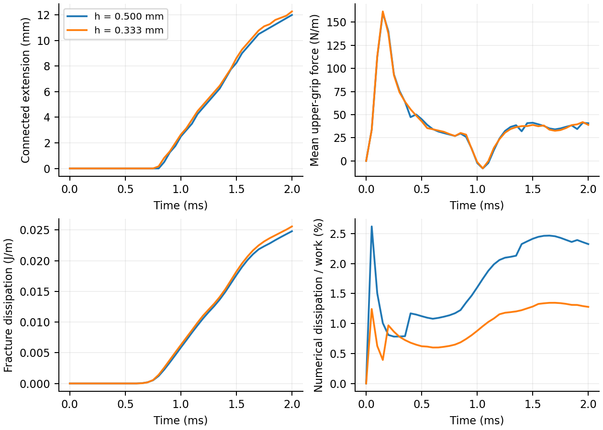

# Localized cohesive fracture

The two arms of a double-cantilever specimen open from their left ends.
Failure progresses from an existing edge crack along a straight cohesive
interface. The bulk response is neo-Hookean; the interface has prescribed
strength and fracture energy, with no assigned crack-tip speed.

<table width="100%">
<tr>
<td width="50%" align="center"><br>Whole specimen</td>
<td width="50%" align="center"><br>Crack-tip detail</td>
</tr>
</table>

## Loading and material

The specimen is 60 mm long and 6 mm high, with a 25 mm edge crack at
mid-height. Each arm is 3 mm thick. Opposing vertical grip velocities reach
1 m/s through a 0.2 ms half-cosine ramp. The calculation lasts 2 ms.

The grip regions are confined to the outer parts of the arms, more than
one quadratic-stencil radius from the interface. This avoids prescribing
the opposite crack face's velocity at shared grid nodes. Horizontal motion
is free at the grips. A distributed roller over the rightmost 2 mm of the
specimen constrains horizontal velocity only; vertical velocity remains free.
This is a physical axial restraint, not merely a coordinate gauge. Its
reaction is recorded separately.

Young's modulus is 30 MPa, Poisson's ratio 0.2 and density 1200 kg/m³.
Cohesive strength is 120 kPa, fracture energy 2 J/m² and stiffness
10¹¹ Pa/m. These are assumed demonstration properties. The peak cohesive
opening is 1.2 µm and complete decohesion occurs at 33.3 µm. The initial
geometric crack starts without tensile bonds or preset damage.

## Boundary and energy checks

This case imposes velocity at the midpoint used for particle and face-marker
motion. An initial grid-velocity projection makes the starting constraint
consistent. Its energy loss is recorded separately from P2G/G2P projection
loss; a stationary constraint does no boundary work. The earlier uniform
tension example retains its original boundary integration as a control.

The saved results track both grip reactions, the axial-roller reaction,
prescribed and observed opening, momentum balance, cohesive energy,
projection losses and nonlinear iteration residuals. The connected crack
length and the total failed interface length are checked separately to detect
failure disconnected from the initial tip. A low-damage softening front is
also recorded; it is not treated as a fully open crack.

The [field checker](../tools/check_dcb_results.py) reconstructs bulk and
cohesive energies, endpoint stress, failed length and deformation symmetry
from the saved fields. The [comparison record](../evidence/cohesive-dcb/validation.json)
retains the two spatial resolutions and their measured differences.

| Grid spacing (mm) | Connected extension at 2 ms (mm) | First saved growth (ms) | Numerical loss / final work | Final mean axial reaction (N/m) |
| --- | --- | --- | --- | --- |
| 0.500 | 12.000 | 0.850 | 2.326% | 20.25 |
| 0.333 | 12.275 | 0.800 | 1.278% | 18.50 |

Lengths refer to the undeformed interface. Growth first appears in saved
frames spaced about 0.05 ms apart; these times do not resolve exact initiation.
Both runs show connected progressive failure, with no detached failed region
above roundoff. The final extensions differ by 2.24% relative to the finer run.
Two resolutions do not establish mesh convergence.

The largest unexplained energy remainder is 3.73×10⁻¹⁴ J/m. The maximum
grip-opening error is 0.079 µm, and reflected particle positions differ by
less than 7.1×10⁻¹⁶ m without averaging the geometry. Numerical loss includes
both transfer and boundary projection. Energy closure verifies the ledger;
it does not establish physical accuracy. The compression penalty permits a
maximum sampled overlap of 0.36 µm.



## Beam-theory scale

For ideal slender, statically loaded arms, the opening compliance per unit
width is `C = 2 a³/(3 E' I')`, where `I' = h³/12` and
`E' = E/(1 - nu²)` for this plane-strain section. The corresponding energy
release rate is `G = P'² a²/(E' I') = 3 P' delta/(2 a)`.
The latter is the uncorrected beam relation described in
[NASA/TM—2018-219883, section 4.1](https://ntrs.nasa.gov/api/citations/20180004403/downloads/20180004403.pdf).

At `a = 25 mm`, these ideal formulas give `E'I' = 0.0703125 N m`,
`C = 1.48148e-4 m²/N`, a critical force of 15 N/m and an opening of
2.222 mm for `Gc = 2 J/m²`. They are scale estimates, not an accuracy gate:
this example has rapid loading, substantial kinetic energy, finite grip
patches, a cohesive process zone and the stated axial restraint. It is not a
quasi-static beam-validation calculation.

## Reproduction

```bash
python examples/cohesive_crack_dcb.py --grid 240 --output outputs/dcb
pvpython --force-offscreen-rendering tools/render_explicit_crack_paraview.py --input outputs/dcb --output outputs/dcb.gif --field principal_stress --stress-max 300000 --center .04 .04 --half-height .034
pvpython --force-offscreen-rendering tools/render_explicit_crack_paraview.py --input outputs/dcb --output outputs/dcb-tip.gif --field stress_yy --stress-max 180000 --center .04 .04 --half-height .018
```

Both views use raw calculated displacement at unit scale and 400×400 frames.
The whole view shows maximum principal stress; the detail shows normal stress
across the interface. Geometry is not symmetrized or modified for rendering.

The model currently assumes a straight potential interface and symmetric
opening. It does not establish arbitrary crack paths, branching, 3D fracture,
or frictional fragment contact. Moving grip masks change their selected grid
nodes as they move; reaction sampling, spatial refinement and the axial
restraint remain relevant to interpreting the transient response.
