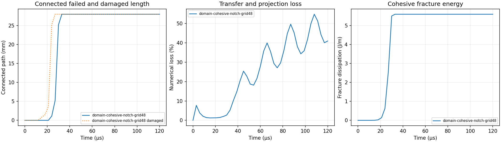
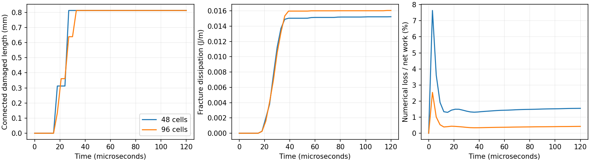

# Prescribed-path Mode-I fracture


The moving-domain solver now includes irreversible tensile softening and
compressive recontact on one planar interface. This first complete trajectory
is a development result: its numerical loss is 40.9% of net applied work,
and strong continued loading softens the remote interface as well as the tip.
It is not included in the homepage gallery or presented as a validated crack
speed or freely selected crack path.

## Interface and loading

The 40 x 20 mm plane-strain plate has a 12 mm initial edge crack on its
horizontal midline. Both sides of the full 40 mm line have separate material
domains and grid fields. The initial crack carries no tensile traction; its
compressive contact remains active. The remaining 28 mm starts bonded, with
zero physical damage and zero opening history. This is an intrinsic cohesive
path with finite intact compliance, not a perfectly tied interface or a
stress-triggered insertion of arbitrary new directions.

The bulk is neo-Hookean with E=3 GPa, Poisson's ratio 0.2 and density
1200 kg/m3. Cohesive stiffness K=1e13 Pa/m, strength S=12 MPa and fracture
energy Gc=200 J/m2 give peak opening d0=S/K and final opening df=2Gc/S.
Positive opening uses a bilinear envelope and irreversible maximum-opening
history h. Unloading follows the secant stiffness. Compression retains the
quadratic penalty even after complete tensile failure.

Stored and dissipated interface energies are evaluated separately. The
implicit traction integrates the exact incremental stored-plus-dissipated
work, including opening through zero, unloading and reloading. Newton trials
do not mutate the accepted history. Softening can make the condensed tangent
indefinite; a sufficient inertial bound is checked before accepting a trial:

\[
\gamma=\frac{\Delta t^2}{4}\frac{S}{d_f-d_0}
\left\|W^{1/2}AM_f^{-1}A^TW^{1/2}\right\|_\infty<0.95.
\]

The infinity norm bounds the largest eigenvalue of the symmetric compliance
matrix. The check protects the solution branch against the most negative
cohesive tangent; it is not a proof of bulk time-step accuracy. For this run,
the largest gamma is below 0.001. Normal remains fixed. Paired quadrature
points share their advected tangential coordinate, preserving normal-force
moment balance; mixed-mode slip and rotating interfaces remain unsupported.

Upper and lower moving grips prescribe +2.5 and -2.5 m/s, respectively, after
a 20 microsecond startup ramp, with horizontal grip velocity fixed. A 1.25 mm
grid and two domains per cell per direction advance 120 microseconds in
2,160 fixed steps. No rejected trial is silently committed or displayed.

## Completed development result

| Quantity | Result |
| --- | --- |
| Initial fracture dissipation | 0 |
| First saved continuous complete failure | 1.125 mm at 24 microseconds |
| Complete failure of the bonded path | 28 mm by 33 microseconds |
| Maximum saved detached failed length | 0 |
| Final fracture dissipation | 5.6 J/m = Gc x 28 mm |
| Largest reconstructed energy remainder | 2.09e-11 J/m |
| Maximum material-boundary / interface-trace drift | 0.241 micrometres |
| Final transfer plus boundary-projection loss / net work | 40.9% |

Front lengths are quadrature-based estimates of the continuous failed region
attached to the initial notch. Between 27 and 30 microseconds that measure
increases from 5.222 to 25.222 mm. Remote softening under the imposed loading
precludes interpreting this jump as a causal crack-tip velocity. Energy
reconstruction establishes accounting consistency, not physical accuracy.



The ParaView GIF contains all 41 rendered states (40 encoded frames after
merging identical initial images). It uses the actual material polygons and
deformation, a 400 x 400 camera, and 0–60 MPa maximum-principal stress. No crack
line or displacement magnification is added. Source revision, inputs, histories,
independent checks and render provenance are in
[`evidence/domain-cohesive`](../evidence/domain-cohesive).

## Opening/hold comparison

A separate displacement-controlled protocol reaches a total grip opening of
30 micrometres over 40 microseconds and then holds. A quintic ramp gives zero
velocity and acceleration at both ends. This reduces direct remote-interface
overloading so notch-led extension or arrest can be examined. It retains the
same material and geometry; it must be compared across its own mesh levels,
not treated as refinement of the continued-velocity run.

The 48-cell hold calculation completed 120 microseconds in 2,160 steps.
Independent reconstruction gives 1.55% final numerical loss, 0.01523 J/m
fracture dissipation and 0.8125 mm connected damaged length. No bonded point
has completely failed. This is a low-opening damage/arrest comparison, not
a completed crack-propagation demonstration. Its maximum energy-accounting
remainder is 1.63e-11 J/m; the original sources match revision `f92a961`.

<table width="100%"><tr>
<td width="50%"></td>
<td width="50%"></td>
</tr></table>

The first 96-cell attempt was rejected before accepting any step. Pulling
the world-coordinate cut plane into each local domain created 128 unresolved
slivers of approximately 1e-21 square metres. The corrected pullback carries
world-coordinate roundoff into the shared cutting plane; it does not delete
positive mass. The initial geometry now has 8,192 active domains, no invalid
integration supports, and conserved area. The fresh 96-cell run from revision
`5a0361c` completed all 4,280 steps and 120 microseconds. Independent
reconstruction verifies its sources and all 41 saved states.

| Final quantity | 48 cells | 96 cells |
| --- | ---: | ---: |
| Connected damaged length | 0.8125 mm | 0.8125 mm |
| Completely failed length | 0 | 0 |
| Fracture dissipation | 0.015231 J/m | 0.016045 J/m |
| Bulk elastic energy | 2.27541 J/m | 2.47502 J/m |
| Numerical loss / net work | 1.5485% | 0.4255% |
| Maximum trace/material-boundary drift | 0.351 micrometres | 0.133 micrometres |



Material, geometric and boundary inputs match. Grid spacing and time step
are refined together at the same nominal CFL. The final fracture dissipation
changes by 5.35%, and bulk elastic energy by 8.77%; matching final damage
lengths do not establish convergence. The fine run's maximum independently
reconstructed energy remainder is 2.57e-11 J/m. This low-opening comparison
does not validate the stronger-loading demonstrations. The
[comparison record](../evidence/domain-cohesive/hold-refinement.json) and
[fine-run evidence](../evidence/domain-cohesive/hold-grid96) retain the
source difference, histories and checks.

Both resolutions use bounded batches of 32 domains and the
separable tile contraction. In a synchronized replay of an actual saved state,
this reduced coupled-step time from 0.308 to 0.206 seconds, with only roundoff
differences. Increasing the batch to 128 was slower and was not adopted.

```bash
python examples/domain_notched_tension.py --grid 48 --output outputs/domain-cohesive-notch-grid48
python tools/check_domain_cohesive.py outputs/domain-cohesive-notch-grid48 --output outputs/domain-cohesive-check
pvpython tools/render_domain_dynamics_paraview.py --input outputs/domain-cohesive-notch-grid48 --output outputs/domain-cohesive-notch-grid48.gif --field principal_stress --stress-max 60000000 --center .03 .03 --parallel-scale .023
python examples/domain_notched_tension.py --grid 48 --loading hold --opening 30e-6 --ramp-time 40e-6 --output outputs/domain-cohesive-hold-grid48
python examples/domain_notched_tension.py --grid 96 --loading hold --opening 30e-6 --ramp-time 40e-6 --output outputs/domain-cohesive-hold-grid96-pullback
```

Finite-tip topology for unrestricted paths, mixed-mode cohesion, general
recontact and spatial/time convergence remain limitations. No further run is
queued in this delivery.

## Additional loading cases

Two completed additions use the existing planar interface: double-edge-notch tension
with a 16 mm intact central ligament, and single-notch opening followed by
unloading and closure. Each begins with zero damage in its bonded region.
The double-notch case measures fronts from both ends without counting the
initial unbonded notches as new failure. The closure case retains irreversible
tensile damage while restoring compressive contact. Both complete all 2,160
steps and 41 saved states. Independent reconstruction checks their geometry,
source hashes, constitutive history and energy ledger. They remain development
demonstrations: final numerical dissipation is large, so accounting closure
does not establish physical accuracy or a causal crack-tip speed.

<table width="100%">
<tr>
<td width="50%"></td>
<td width="50%"></td>
</tr>
<tr>
<td width="50%"></td>
<td width="50%"></td>
</tr>
</table>

| Quantity | Double notch | Opening and recontact |
| --- | ---: | ---: |
| Complete history | 120 microseconds | 120 microseconds |
| First saved fully failed bonded point | 27 microseconds | 27 microseconds |
| Entire bonded ligament failed by | 33 microseconds | 42 microseconds |
| Fully failed bonded length | 16 mm | 28 mm |
| Fracture dissipation | 3.2 J/m | 5.6 J/m |
| Net external work | 8.37673 J/m | 15.92839 J/m |
| Transfer plus boundary-projection loss | 4.43956 J/m | 9.82404 J/m |
| Numerical loss / net work | 53.00% | 61.68% |

The unloading run reaches a saved compressive gap of -2.065 micrometres,
corresponding to 20.65 MPa under its penalty law. Maximum sampled detached
failed and damaged lengths are zero in both cases. These connectivity checks
do not establish tip causality: a continuous softening region can still
develop under remote loading.

Each ParaView animation uses computed polygons at their actual deformation,
a fixed 0–20 MPa principal-stress range, and a 400 x 400 frame. The lower row
uses a fixed 5 x 5 mm camera around the initial left crack tip; it changes
the camera only. All 41 states are rendered. The local GIFs encode 40 frames
after merging duplicate images. Compact histories and checks are in
[`double-notch-grid48`](../evidence/domain-cohesive/double-notch-grid48) and
[`opening-closure-grid48`](../evidence/domain-cohesive/opening-closure-grid48).

Both first runs use 80 micrometres total peak grip opening and the 48-cell
grid over 120 microseconds. Double-notch loading reaches its held opening
in 40 microseconds. Opening/closure uses a cosine displacement cycle with
its peak at 40 microseconds and returns to zero at 80 microseconds, then
holds the grips. They start from virgin states at revision `1b268a6`.
Per-tip lengths can overlap after the central ligament completely fails;
the combined connected length counts their union once.

```bash
python examples/domain_notched_tension.py --grid 48 --notch double --loading hold --opening 80e-6 --ramp-time 40e-6 --output outputs/domain-cohesive-double-notch-grid48
python examples/domain_notched_tension.py --grid 48 --loading pulse --opening 80e-6 --period 80e-6 --output outputs/domain-cohesive-opening-closure-grid48
```

Hole interaction, three-point bending, and interacting non-collinear cracks
were proposed extensions and are not part of the user's final closeout scope.
A prescribed planar interface cannot establish freely selected turning or
branching paths.

The archived trajectory's exact sources are verified against revision
`1d339ac`. Pass `--source-commit 1d339ac` when checking those original raw
outputs; later reruns must name their own source revision or omit the option.
