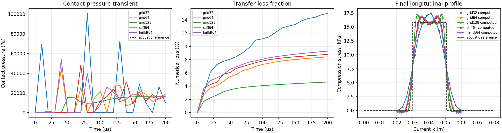

# Implicit planar contact on material domains


This advances two separated material-domain fields through a complete elastic
bar collision. It addresses the contact stiffness bottleneck without filtering
small nodal masses or changing the pressure law. It is not yet the contact
implementation used by the finite-tip fracture examples.

## Discretization

Bulk force and deformation rate use the same volume-averaged quadratic basis.
The contact traces use unfiltered quadratic basis values. Initial straight-line
integration is split at the actual half-grid spline knots, with three Gauss
points per interval. A frozen unit-pressure check at three cut angles and
offsets gives a maximum interior bulk/contact force imbalance of 2.30e-15.
This checks integration; a zero-gap penalty interface does not carry a nonzero
initial pressure and is not claimed to be an equilibrated prestressed state.

With opening g, the contact potential is U(g)=K min(g,0)^2/2. The force uses
the secant of this same potential between the old and new gap. Eliminating the
free grid velocities leaves a small nonlinear system for the new gaps z:

\[
z=g+\Delta t A(v_0+v_{\mathrm{free}})/2
  -\frac{\Delta t^2}{2}A M_f^{-1}A^T W\,t(g,z).
\]

A gathers relative normal velocity, W contains positive line weights, and
M_f excludes prescribed velocity components. Damped Newton solves this
system; its generally nonsymmetric Jacobian is not treated as SPD. Force
scatter is the transpose of A, so its work agrees with the contact-energy
increment. Constraint reaction work includes the contact force on prescribed
degrees of freedom. Failed solves invalidate the trial; they are not committed.

The interface retains common spatial tangential coordinates and moves its
normal traces. Normal direction and quadrature weights are fixed within each
step. This preserves the paired normal-force moment but restricts the current
implementation to planar contact. Finite sliding, changing contact extent,
rotating normals and cohesive failure require further development.

## Collision and comparison

The combined bar occupies x=20–60 mm and y=35–45 mm, cut completely at
x=40.3 mm. The left and right pieces initially travel toward each other at
0.25 m/s. Transverse velocity is constrained to zero throughout; longitudinal
ends are free. The bulk is compressible neo-Hookean with E=3 MPa, Poisson's
ratio 0.2 and density 1200 kg/m3. Every run completes 0.2 ms, before the first
end reflection. Only positive-area fragments are retained after initialization;
no small positive mass is deleted.

For a small-strain longitudinal collision, c=sqrt((lambda+2mu)/rho) and
p=rho*c*v give c=52.7046 m/s and p=15.8114 kPa. This is an approximate acoustic
reference for the nonlinear bulk. It is not a nonlinear exact solution.

| Grid | K (Pa/m) | dt (microseconds) | Steps | Mean contact pressure (kPa) | Final plateau pressure (kPa) | Numerical loss / initial energy |
| --- | --- | --- | --- | --- | --- | --- |
| 32 | 1e11 | 3.3333 | 60 | 16.268 | 15.536 | 15.00% |
| 64 | 1e11 | 1.6667 | 120 | 15.842 | 16.698 | 8.43% |
| 128 | 1e11 | 0.8333 | 240 | 15.814 | 15.794 | 4.63% |
| 64 | 1e13 | 1.6667 | 120 | 15.852 | 16.651 | 8.80% |
| 64 | 1e11 | 0.8333 | 240 | 15.851 | 16.669 | 9.29% |

All runs keep their prescribed time step. Increasing contact stiffness by
100 times does not trigger time-step reduction. Spatial refinement reduces
transfer loss, whereas halving the step at fixed grid slightly increases it.
The finest-grid final plateau is 0.11% below the acoustic pressure; the
coarser errors are not monotonic, so this is not a convergence claim.
Initial contact-pressure overshoots and subsequent oscillations are retained
in the history plots. A close mean impulse does not validate those oscillations.



The material-domain boundary and independently advanced normal trace are
compared explicitly. Their drift is reported alongside the penalty overlap;
the trace is not used to draw an artificial crack. Changing domain moments
remain a separately recorded numerical energy term. Contact work agreement
does not eliminate APIC transfer losses or establish fracture accuracy.

The ParaView animation uses the actual material polygons, a fixed 400 x 400
view and longitudinal compression from 0 to 20 kPa. It contains 21 distinct
frames, with no displacement amplification. Compact histories, independently
reconstructed field checks and provenance are in
[`evidence/domain-contact`](../evidence/domain-contact).

```bash
python examples/domain_bar_collision.py --grid 128 --output outputs/domain-contact-collision-grid128
python examples/domain_bar_collision.py --grid 64 --stiffness 1e13 --output outputs/domain-contact-collision-stiff64
python examples/domain_bar_collision.py --grid 64 --dt-scale .5 --output outputs/domain-contact-collision-halfdt64
python tools/audit_domain_contact_patch.py --output outputs/domain-contact-patch.json
python tools/check_domain_contact.py outputs/domain-contact-collision-grid32 outputs/domain-contact-collision-grid64 outputs/domain-contact-collision-grid128 outputs/domain-contact-collision-stiff64 outputs/domain-contact-collision-halfdt64 --output outputs/domain-contact-check
pvpython tools/render_domain_dynamics_paraview.py --input outputs/domain-contact-collision-grid128 --output outputs/domain-contact-collision-grid128.gif --field compression_x --stress-max 20000
```

The subsequent [Mode-I cohesive branch](DOMAIN_COHESIVE.md) adds irreversible
opening and compressive recontact on a prescribed planar path. Finite-tip
topology for unrestricted paths and evolving contact geometry remain required
before replacing the stopped offset-notch, inclined-notch and bending
calculations. Those cases must be recomputed
with the new discretization; their old snapshots are diagnostic inputs, not
interchangeable states for the new moment and transfer operators.
