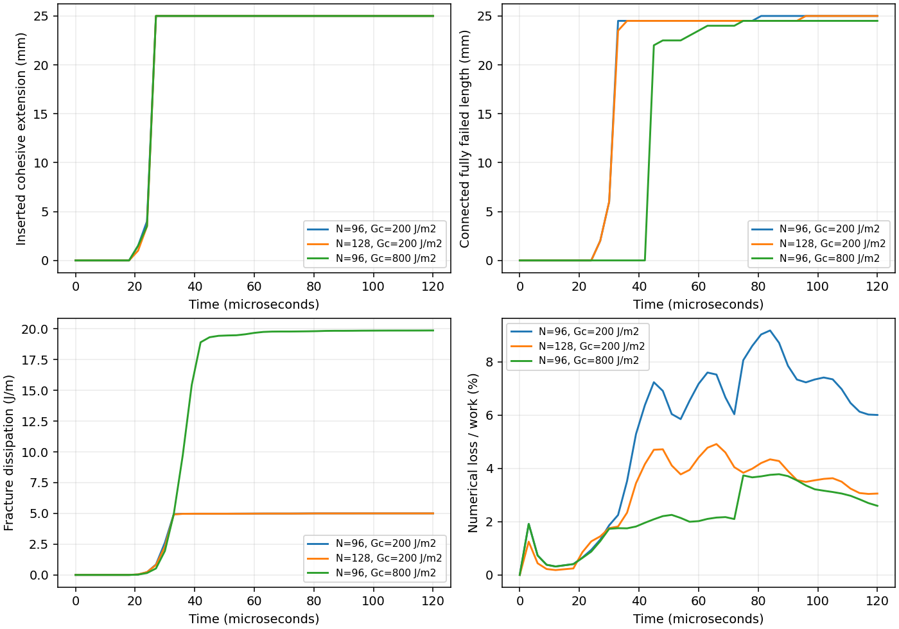

# Energy-controlled cohesive insertion

The moving-polyline branch now inserts cohesive segments carrying the sampled
pre-insertion traction. Their strength decreases with separation and their
complete failure consumes a prescribed fracture energy. The geometric front
and the connected, fully failed length are recorded separately.

<table width="100%">
<tr>
<td width="50%" align="center"><br>Gc = 200 J/m²</td>
<td width="50%" align="center"><br>Gc = 800 J/m²</td>
</tr>
</table>

This follows the adaptive insertion principle described by
[Pandolfi and Ortiz](https://authors.library.caltech.edu/records/62t2m-kw964).
Initializing nonzero traction at zero separation distinguishes dynamically
inserted interfaces from initially unstressed intrinsic interfaces, as outlined
in the [Sierra/SM manual](https://www.sandia.gov/files/sierra/SM_Development_5_30/main/cohesive.html).
The regularized law and JAX implementation here are independent choices;
they are not copies of either implementation.

## Interface law

Each segment uses two Gauss points and a frame derived from its moving
centreline. Let `g` be the local separation, `t0` the sampled birth-traction
vector, `s = |t0|`, and `K` the regularizing stiffness. Define

```text
r0 = s/K
r  = |g + t0/K|
w  = 2 Gc/s
m  = min(r0+w, max(previous m, r0, r))
z  = (m-r0)/w
k  = K (r0/m) (1-z)
Psi = 0.5 k r² - 0.5 s r0 (1-z)
D   = Gc z
```

At insertion, `g=0`, `Psi=D=0`, and the interface traction equals `t0`.
Energy densities use each segment's length at insertion and unit thickness.
In monotonic pure opening, traction decreases linearly from `s` to zero over
`w`; the work to complete separation is `Gc`. Unloading follows the shifted
elastic branch. `Psi` is referenced to insertion and can be negative during
unloading; it is not an absolute elastic energy. A separate normal compression
penalty acts on negative physical gaps. General mixed-mode closure and
fragment contact are not validated by the opening examples.

JAX differentiates the co-rotating segment potential to obtain endpoint forces.
A discrete-gradient correction matches interface work to the change in
`Psi+D`. Its correction direction excludes rigid translation and rotation.
Near rigid motion, the denominator is checked against coordinate-roundoff
resolution rather than divided by an arbitrarily tiny number. Segment-level
resultant, moment, frame invariance and work are checked independently. This
does not establish exact angular-momentum conservation of the entire MPM
transfer and time integration.

The bulk uses the energy-conjugate midpoint update from the
[straight cohesive solver](COHESIVE_DCB.md). Face advection and nodal forces
use the same interpolation weights. Mass-weighted moving least squares enforces
constant and linear reproduction on occupied nodes. A rank-deficient face
stencil invalidates the step. This also preserves the force resultant and
moment at the interpolation configuration; normalizing truncated shape weights
alone failed the affine-field check. The energy ledger separates boundary work,
bulk and interface storage, fracture dissipation, transfer losses, boundary
projection losses and any instantaneous insertion-energy change.

## Insertion and example

The tip averages stress in a forward half-disc of radius 1.5 mm. A candidate
tangent follows the tensile principal direction's normal, with at most a 45°
turn relative to the last segment. When tensile traction on that plane reaches
the initiation threshold, a 0.5 mm segment is inserted. There is no assigned
tip speed. The sampled traction initializes that segment; averaging does not
guarantee exact cancellation of the discrete nodal force jump at insertion.

The demonstration retains the 40 × 20 mm neo-Hookean plate, initial 15° edge
crack, 3 GPa modulus, Poisson's ratio 0.2 and density 1200 kg/m³.
Upper and lower grip strips reach opposing 2 m/s vertical velocities through
a 20 µs half-cosine ramp; their horizontal velocity is zero. Initiation strength
is 12 MPa and interface stiffness is 10¹³ Pa/m. Parameters are assumed.

The insertion region permits at most 25 mm of new cohesive interface, ending
inside the plate. Reaching that cap is a geometric restriction, not a prediction
of physical crack arrest. Uniform loading can activate a broad cohesive zone;
its front speed must not be interpreted as the speed of a traction-free crack.

The two ParaView animations use the same coarser mesh, the complete 120 µs
loading history, computed positions and deformation gradients, a common
0–60 MPa principal-stress scale, and 400×400 frames. Displacements are not
amplified and no crack line is drawn. Both material parameters and numerical
resolution matter; the separate finer-mesh calculation is retained in the
[field-validation record](../evidence/extrinsic-crack/validation.json).



| Gc (J/m²) | Grid spacing (mm) | First saved connected failure (µs) | Fully failed length at 120 µs (mm) | Fracture dissipation (J/m) | Numerical loss / final work |
| --- | --- | --- | --- | --- | --- |
| 200 | 0.625 | 27 | 25.0 | 5.000 | 6.01% |
| 200 | 0.469 | 27 | 25.0 | 5.000 | 3.05% |
| 800 | 0.625 | 45 | 24.5 | 19.870 | 2.59% |

Saved states are approximately 3 µs apart. The high-toughness case temporarily
develops failed segments disconnected from the original crack, over a maximum
total length of 17.5 mm. The broad stressed interface therefore does not provide
a localized crack-front-speed benchmark. Its different failure timing and
dissipation are a toughness control, not evidence of path or mesh convergence.

The coarser 200 J/m² run fully fails all 25 mm of inserted interface: its
fracture dissipation is `200 × 0.025 = 5 J/m`. The 800 J/m² run retains a
partly cohesive terminal segment. Numerical loss and fracture dissipation
are recorded separately; exact energy bookkeeping does not establish accuracy
of the transient response.

Across all three trajectories, the largest reconstructed energy remainder is
3.37×10⁻¹¹ J/m, and the largest cumulative insertion-energy change is
1.30×10⁻¹⁸ J/m. Saved face gaps remain nonnegative. The field checker also
reconstructs bulk stress, APIC kinetic energy and irreversible interface history.
The [refined animation](images/extrinsic-refined.gif) uses the same colour scale
and physical duration. Agreement of the final failed length is limited by the
common insertion cap and is not a convergence criterion.

```bash
python examples/extrinsic_crack_tension.py --grid 128 --output outputs/extrinsic
pvpython --force-offscreen-rendering tools/render_explicit_crack_paraview.py --input outputs/extrinsic --output outputs/extrinsic.gif --field principal_stress --stress-max 60000000 --center .03 .03 --half-height .023
```

The driver enables JAX 64-bit arithmetic. The energy correction and these
checks are qualified in double precision on CPU; float32 and GPU execution
are not qualified here.

Moving, turning cohesive insertion is implemented, but this is not a validated
general fracture solver. Localized mixed-mode loading, nodal traction balance
at insertion, spatial/time/insertion-spacing convergence, branching, 3D crack
surfaces and general fragment recontact remain open.
