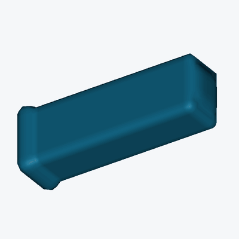
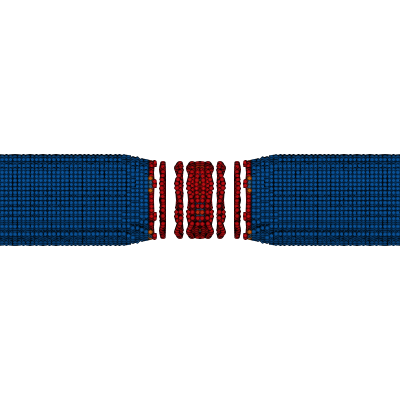
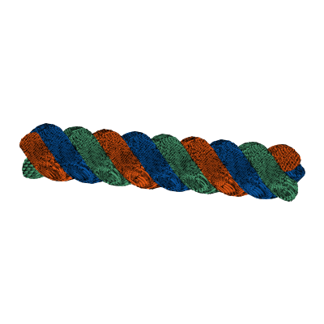
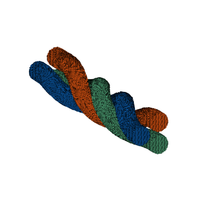
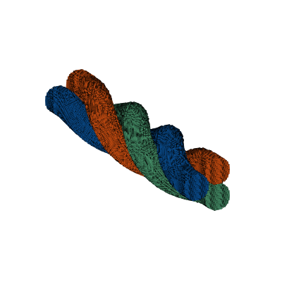
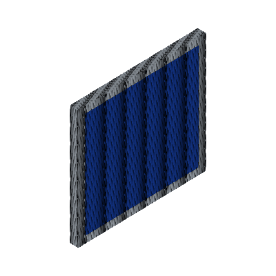

# Gallery

ParaView frames and animations. [Run records](RESULTS.md).

## JAX design

Differentiable 3D MPM material-layout design. These independent 400 × 400
ParaView animations show the same y-load case and camera for the uniform
reference and feasible optimized design; deformation is shown at its original
scale. See the [design method and numerical evidence](STRUCTURAL_DESIGN.md).

<table width="100%">
<tr>
<td width="33%" align="center"> <strong>Uniform reference · y load</strong></td>
<td width="33%" align="center"> <strong>Optimized layout · y load</strong></td>
<td width="33%" align="center"></td>
</tr>
<tr>
<td width="33%" align="center"> <a href="COMBINED_BRACKET_DESIGN.md">Perforated bracket · initial</a></td>
<td width="33%" align="center"> <a href="COMBINED_BRACKET_DESIGN.md">Perforated bracket · optimized</a></td>
<td width="33%" align="center"></td>
</tr>

<tr>
<td width="33%" align="center"> <a href="JAX_ORTHOTROPIC_INVERSE.md">Orthotropic inverse · holdout</a></td>
<td width="33%" align="center"></td>
<td width="33%" align="center"></td>
</tr>
<tr>
<td width="33%" align="center"> <a href="JAX_CLASSIC_CANTILEVER.md">Classic cantilever material layout</a></td>
<td width="33%" align="center"></td>
<td width="33%" align="center"></td>
</tr>
</table>

## Fibres

<table width="100%">
<tr>
<td width="33%" align="center"> <strong>Single fibre tension</strong> <a href="results/fibres--single-fibre-tension/summary.json">Results</a> &middot; <a href="images/home/fibres--single-fibre-tension.gif">GIF</a></td>
<td width="33%" align="center"></td>
<td width="33%" align="center"></td>
</tr>
<tr>
<td width="33%" align="center"> <strong>crossed-fibre-hertz</strong> <a href="results/completed--crossed-fibre-hertz/summary.json">Results</a> · <a href="images/home/completed--crossed-fibre-hertz.gif">GIF</a></td>
<td width="33%" align="center"> <strong>Crossed fibre MD contact</strong> <a href="results/completed--crossed-fibre-md/summary.json">Results</a> · <a href="images/home/completed--crossed-fibre-md.gif">GIF</a></td>
<td width="33%" align="center"> <strong>Crossed fibre JKR contact</strong> <a href="results/completed--crossed-fibre-jkr/summary.json">Results</a> · <a href="images/home/completed--crossed-fibre-jkr.gif">GIF</a></td>
</tr>
<tr>
<td width="33%" align="center"> <strong>Three-strand tension</strong> <a href="results/fibres--three-strand-tension/summary.json">Results</a> &middot; <a href="images/home/fibres--three-strand-tension.gif">GIF</a></td>
<td width="33%" align="center"> <strong>Three-strand forming</strong> <a href="results/fibres--three-strand-forming/summary.json">Results</a> &middot; <a href="images/home/fibres--three-strand-forming.gif">GIF</a></td>
<td width="33%" align="center"> <strong>Dry three-strand forming</strong> <a href="results/fibres--dry-three-strand-forming/summary.json">Results</a> &middot; <a href="images/home/fibres--dry-three-strand-forming.gif">GIF</a></td>
</tr>
</table>

## Woven composites: plate impact

<table width="100%">
<tr>
<td width="33%" align="center"> <strong>Deep woven plate impact</strong> <a href="results/completed--woven-plate-impact/summary.json">Results</a> &middot; <a href="images/home/completed--woven-plate-impact.gif">GIF</a> &middot; <a href="images/woven-plate-impact-detail.gif">Detail GIF</a></td>
<td width="33%" align="center"></td>
<td width="33%" align="center"></td>
</tr>
</table>

## Woven composites: plain weave

<table width="100%">
<tr>
<td width="33%" align="center"> <strong>woven-plain-in-plane-shear</strong> <a href="results/woven--plain--in-plane-shear/summary.json">Results</a> · <a href="images/woven-plain-in-plane-shear.mp4">Video</a></td>
<td width="33%" align="center"> <strong>woven-plain-warp-tension</strong> <a href="results/woven--plain--warp-tension/summary.json">Results</a> · <a href="images/woven-plain-warp-tension.mp4">Video</a></td>
<td width="33%" align="center"> <strong>woven-plain-weft-tension</strong> <a href="results/woven--plain--weft-tension/summary.json">Results</a> · <a href="images/woven-plain-weft-tension.mp4">Video</a></td>
</tr>
</table>

## Woven composites: triaxial weave

<table width="100%">
<tr>
<td width="33%" align="center"> <strong>woven-triaxial-in-plane-shear</strong> <a href="results/woven--triaxial--in-plane-shear/summary.json">Results</a> · <a href="images/woven-triaxial-in-plane-shear.mp4">Video</a></td>
<td width="33%" align="center"> <strong>woven-triaxial-warp-tension</strong> <a href="results/woven--triaxial--warp-tension/summary.json">Results</a> · <a href="images/woven-triaxial-warp-tension.mp4">Video</a></td>
<td width="33%" align="center"> <strong>woven-triaxial-weft-tension</strong> <a href="results/woven--triaxial--weft-tension/summary.json">Results</a> · <a href="images/woven-triaxial-weft-tension.mp4">Video</a></td>
</tr>
</table>

## Woven composites: twill weave

<table width="100%">
<tr>
<td width="33%" align="center"> <strong>woven-twill-2x2-in-plane-shear</strong> <a href="results/woven--twill-2x2--in-plane-shear/summary.json">Results</a> · <a href="images/woven-twill-2x2-in-plane-shear.mp4">Video</a></td>
<td width="33%" align="center"> <strong>woven-twill-2x2-warp-tension</strong> <a href="results/woven--twill-2x2--warp-tension/summary.json">Results</a> · <a href="images/woven-twill-2x2-warp-tension.mp4">Video</a></td>
<td width="33%" align="center"> <strong>woven-twill-2x2-weft-tension</strong> <a href="results/woven--twill-2x2--weft-tension/summary.json">Results</a> · <a href="images/woven-twill-2x2-weft-tension.mp4">Video</a></td>
</tr>
</table>

## Metals

<table width="100%">
<tr>
<td width="33%" align="center"> <a href="results/completed--jc-necking-refined/summary.json">JC round-bar necking</a></td>
<td width="33%" align="center"> <a href="results/completed--pressure-panel-jc/summary.json">JC pressure pulse panel</a></td>
<td width="33%" align="center"></td>
</tr>
<tr>
<td width="33%" align="center"> <a href="results/completed--pressure-panel-jc-75mpa-damage/summary.json">JC panel · 75 MPa · backside damage</a></td>
<td width="33%" align="center"></td>
<td width="33%" align="center"></td>
</tr>
</table>

## Concrete

<table width="100%">
<tr>
<td width="33%" align="center"> <strong>concrete-bending-symmetric</strong> <a href="results/material-engineering--concrete-bending-symmetric--hjc/summary.json">Results</a> · <a href="images/concrete-bending-symmetric.mp4">Video</a></td>
<td width="33%" align="center"> <a href="results/completed--pressure-panel-hjc/summary.json">HJC legacy-v3 pressure pulse panel</a></td>
<td width="33%" align="center"></td>
</tr>
<tr>
<td width="33%" align="center"> <a href="results/completed--pressure-panel-hjc-25mpa-damage/summary.json">HJC panel · 25 MPa · backside damage</a></td>
<td width="33%" align="center"></td>
<td width="33%" align="center"></td>
</tr>
</table>

## Ceramics

<table width="100%">
<tr>
<td width="33%" align="center"> <strong>ceramic-impact-debris</strong> <a href="results/completed--ceramic-impact-debris/summary.json">Results</a> · <a href="images/home/completed--ceramic-impact-debris.gif">GIF</a></td>
<td width="33%" align="center"> <a href="results/completed--pressure-panel-jh2/summary.json">JH-2 pressure pulse panel</a></td>
<td width="33%" align="center"></td>
</tr>
</table>

## Geotechnical mechanics

A small-strain response to a recorded strength reduction; it is not a complete
landslide or a validated site prediction. See the [model scope and result](MAT173_LANDSLIDE.md).

<table width="100%">
<tr>
<td width="33%" align="center"> <strong>Strength-reduced slope response</strong> <a href="results/material-engineering--mat173-strength-reduced-slope-response/summary.json">Results</a> · <a href="images/home/mat173-strength-reduced-slope-response.gif">GIF</a></td>
<td width="33%" align="center"></td>
<td width="33%" align="center"></td>
</tr>
</table>

## Adhesive surface contact

<table width="100%">
<tr>
<td width="33%" align="center"> <strong>adhesion-visible-nonadhesive-pull-off</strong> <a href="results/adhesion-visible--nonadhesive-pull-off/summary.json">Results</a> · <a href="images/adhesion-visible-nonadhesive-pull-off.mp4">Video</a></td>
<td width="33%" align="center"> <strong>adhesion-visible-adhesive-pull-off</strong> <a href="results/adhesion-visible--adhesive-pull-off/summary.json">Results</a> · <a href="images/adhesion-visible-adhesive-pull-off.mp4">Video</a></td>
<td width="33%" align="center"> <strong>Radial sinusoidal pull-off</strong> <a href="results/completed--radial-sinusoidal-pull-off/summary.json">Results</a> · <a href="images/home/completed--radial-sinusoidal-pull-off.gif">GIF</a></td>
</tr>
<tr>
<td width="33%" align="center"> <strong>adhesion-lateral-release</strong> <a href="results/adhesion--lateral-release/summary.json">Results</a> · <a href="images/adhesion-lateral-release.mp4">Video</a></td>
<td width="33%" align="center"> <strong>adhesion-three-sphere-array</strong> <a href="results/adhesion--three-sphere-array/summary.json">Results</a> · <a href="images/adhesion-three-sphere-array.mp4">Video</a></td>
<td width="33%" align="center"></td>
</tr>
</table>

## Nonadhesive contact

<table width="100%">
<tr>
<td width="33%" align="center"> <strong>ball-beam</strong> <a href="results/benchmarks--ball-beam--neo-hookean/summary.json">Results</a> · <a href="images/ball-beam.mp4">Video</a></td>
<td width="33%" align="center"> <strong>oblique</strong> <a href="results/suite--oblique--neo-hookean/summary.json">Results</a> · <a href="images/oblique.mp4">Video</a></td>
<td width="33%" align="center"> <strong>rebound</strong> <a href="results/suite--rebound--neo-hookean/summary.json">Results</a></td>
</tr>
<tr>
<td width="33%" align="center"> <strong>rubber-ball</strong> <a href="results/benchmarks--rubber-ball--neo-hookean/summary.json">Results</a> · <a href="images/rubber-ball.mp4">Video</a></td>
<td width="33%" align="center"> <strong>sliding</strong> <a href="results/suite--sliding--neo-hookean/summary.json">Results</a></td>
<td width="33%" align="center"> <strong>sphere-contact</strong> <a href="results/contact-models--sphere-contact/summary.json">Results</a> · <a href="images/sphere-contact.mp4">Video</a></td>
</tr>
</table>

## Fluid dynamics

<table width="100%">
<tr>
<td width="33%" align="center"> <strong>dam-break</strong> <a href="results/suite--dam-break--neo-hookean/summary.json">Results</a> · <a href="images/dam-break.mp4">Video</a></td>
<td width="33%" align="center"> <strong>sloshing</strong> <a href="results/suite--sloshing--neo-hookean/summary.json">Results</a></td>
<td width="33%" align="center"> <strong>unbaffled-tank</strong> <a href="results/engineering--unbaffled-tank--neo-hookean/summary.json">Results</a> · <a href="images/unbaffled-tank.mp4">Video</a></td>
</tr>
</table>

## Fluid-solid interaction

<table width="100%">
<tr>
<td width="33%" align="center"> <strong>baffled-tank</strong> <a href="results/engineering--baffled-tank--neo-hookean/summary.json">Results</a> · <a href="images/baffled-tank.mp4">Video</a></td>
<td width="33%" align="center"> <strong>elastic-gate</strong> <a href="results/benchmarks--elastic-gate--neo-hookean/summary.json">Results</a> · <a href="images/elastic-gate.mp4">Video</a></td>
<td width="33%" align="center"> <strong>floating-block</strong> <a href="results/benchmarks--floating-block--neo-hookean/summary.json">Results</a> · <a href="images/floating-block.mp4">Video</a></td>
</tr>
<tr>
<td width="33%" align="center"> <strong>fsi</strong> <a href="results/suite--fsi--neo-hookean/summary.json">Results</a> · <a href="images/fsi.mp4">Video</a></td>
<td width="33%" align="center"> <strong>water-entry</strong> <a href="results/production--water-entry--neo-hookean/summary.json">Results</a> · <a href="images/water-entry.mp4">Video</a></td>
<td width="33%" align="center"></td>
</tr>
</table>

## Structural elasticity

<table width="100%">
<tr>
<td width="33%" align="center"> <strong>cellular-cushion</strong> <a href="results/engineering--cellular-cushion--neo-hookean/summary.json">Results</a> · <a href="images/cellular-cushion.mp4">Video</a></td>
<td width="33%" align="center"> <strong>large-bending</strong> <a href="results/benchmarks--large-bending--neo-hookean/summary.json">Results</a> · <a href="images/large-bending.mp4">Video</a></td>
<td width="33%" align="center"> <strong>large-twist</strong> <a href="results/benchmarks--large-twist--neo-hookean/summary.json">Results</a> · <a href="images/large-twist.mp4">Video</a></td>
</tr>
<tr>
<td width="33%" align="center"> <strong>perforated-panel</strong> <a href="results/engineering--perforated-panel--neo-hookean/summary.json">Results</a> · <a href="images/perforated-panel.mp4">Video</a></td>
<td width="33%" align="center"> <strong>visible-cantilever</strong> <a href="results/visible-motion--cantilever--neo-hookean/summary.json">Results</a> · <a href="images/visible-cantilever.mp4">Video</a></td>
<td width="33%" align="center"> <strong>visible-shear</strong> <a href="results/visible-motion--shear--neo-hookean/summary.json">Results</a> · <a href="images/visible-shear.mp4">Video</a></td>
</tr>
<tr>
<td width="33%" align="center"> <strong>visible-surface-load</strong> <a href="results/visible-motion--surface-load--neo-hookean/summary.json">Results</a> · <a href="images/visible-surface-load.mp4">Video</a></td>
<td width="33%" align="center"> <strong>visible-torsion</strong> <a href="results/visible-motion--torsion--neo-hookean/summary.json">Results</a> · <a href="images/visible-torsion.mp4">Video</a></td>
<td width="33%" align="center"></td>
</tr>
</table>
