# Gallery

Selected ParaView frames and videos from completed runs. Every material point is rendered.
Body colours distinguish contacting bodies; damage colours use a fixed range
over time. [Run records](RESULTS.md) contain
the parameters and numerical results.

## Material engineering

| | |
|---|---|
| 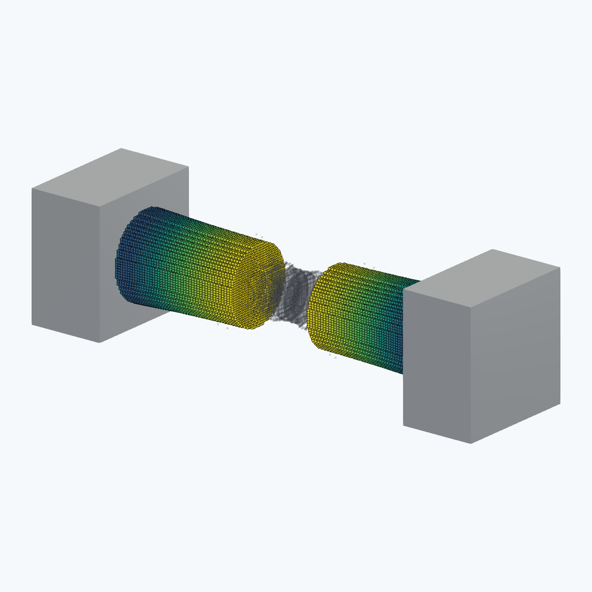 **jc-tension** · 146,880 particles [Results](results/material-engineering--jc-tension--johnson-cook/summary.json) · [Video](images/jc-tension.mp4) | |
| 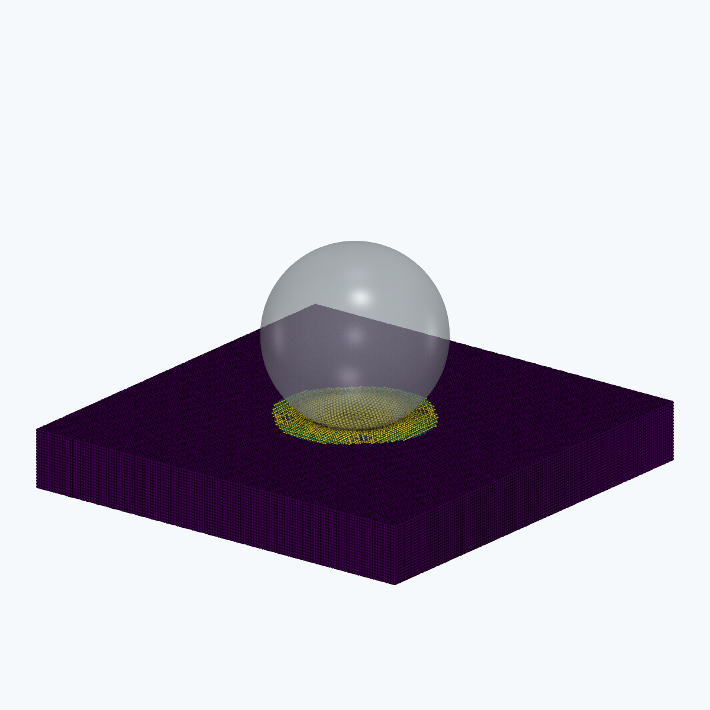 **ceramic-indentation-wide** · 386,420 particles [Results](results/material-engineering--ceramic-indentation-wide--jh2/summary.json) · [Video](images/ceramic-indentation-wide.mp4) |  |

## Engineering structures and tanks

| | |
|---|---|
|  **perforated-panel** · 97,536 particles [Results](results/engineering--perforated-panel--neo-hookean/summary.json) · [Video](images/perforated-panel.mp4) |  **cellular-cushion** · 192,180 particles [Results](results/engineering--cellular-cushion--neo-hookean/summary.json) · [Video](images/cellular-cushion.mp4) |
|  **baffled-tank** · 363,352 particles [Results](results/engineering--baffled-tank--neo-hookean/summary.json) · [Video](images/baffled-tank.mp4) |  **unbaffled-tank** · 342,144 particles [Results](results/engineering--unbaffled-tank--neo-hookean/summary.json) · [Video](images/unbaffled-tank.mp4) |

## Dynamics and contact

| | |
|---|---|
|  **sphere-contact** · 386,019 particles [Results](results/contact-models--sphere-contact/summary.json) · [Video](images/sphere-contact.mp4) | 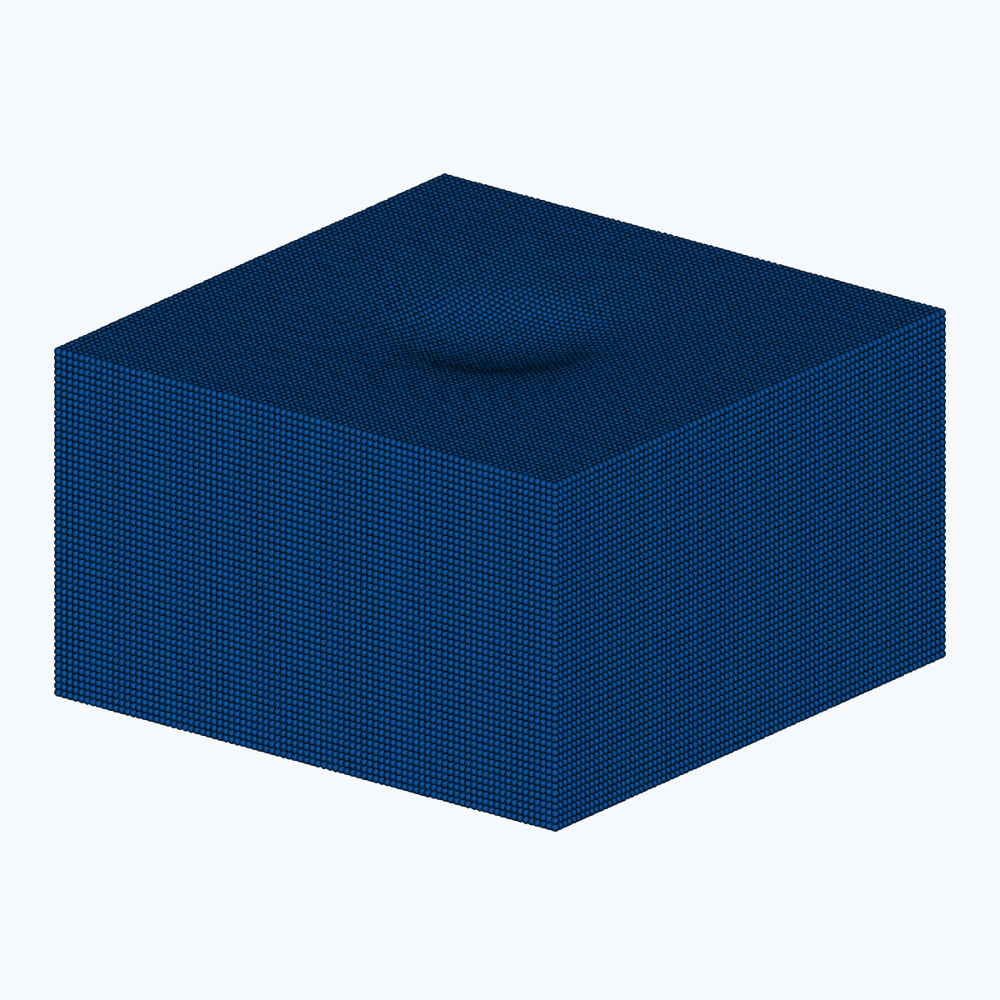 **jkr-footprint** · 386,019 particles [Results](results/contact-models--jkr-footprint/summary.json) · [Video](images/jkr-footprint.mp4) |
|  **oblique** · 38,686 particles [Results](results/suite--oblique--neo-hookean/summary.json) · [Video](images/oblique.mp4) |  **sliding** · 16,704 particles [Results](results/suite--sliding--neo-hookean/summary.json) |
|  **rebound** · 24,389 particles [Results](results/suite--rebound--neo-hookean/summary.json) |  **rubber-ball** · 44,720 particles [Results](results/benchmarks--rubber-ball--neo-hookean/summary.json) · [Video](images/rubber-ball.mp4) |
|  **ball-beam** · 88,583 particles [Results](results/benchmarks--ball-beam--neo-hookean/summary.json) · [Video](images/ball-beam.mp4) |  **large-bending** · 119,944 particles [Results](results/benchmarks--large-bending--neo-hookean/summary.json) · [Video](images/large-bending.mp4) |
|  **large-twist** · 119,944 particles [Results](results/benchmarks--large-twist--neo-hookean/summary.json) · [Video](images/large-twist.mp4) |  **adhesion-lateral-release** · 367,744 particles [Results](results/adhesion--lateral-release/summary.json) · [Video](images/adhesion-lateral-release.mp4) |
|  **adhesion-three-sphere-array** · 367,744 particles [Results](results/adhesion--three-sphere-array/summary.json) · [Video](images/adhesion-three-sphere-array.mp4) |  |

## Fluids and fluid–solid interaction

| | |
|---|---|
|  **dam-break** · 66,096 particles [Results](results/suite--dam-break--neo-hookean/summary.json) · [Video](images/dam-break.mp4) |  **sloshing** · 82,944 particles [Results](results/suite--sloshing--neo-hookean/summary.json) |
|  **fsi** · 85,776 particles [Results](results/suite--fsi--neo-hookean/summary.json) · [Video](images/fsi.mp4) |  **elastic-gate** · 357,912 particles [Results](results/benchmarks--elastic-gate--neo-hookean/summary.json) · [Video](images/elastic-gate.mp4) |
|  **floating-block** · 384,373 particles [Results](results/benchmarks--floating-block--neo-hookean/summary.json) · [Video](images/floating-block.mp4) |  **water-entry** · 1,327,400 particles [Results](results/production--water-entry--neo-hookean/summary.json) · [Video](images/water-entry.mp4) |

## Finite deformation and prescribed loading

| | |
|---|---|
|  **visible-cantilever** · 119,944 particles [Results](results/visible-motion--cantilever--neo-hookean/summary.json) · [Video](images/visible-cantilever.mp4) |  **visible-shear** · 242,208 particles [Results](results/visible-motion--shear--neo-hookean/summary.json) · [Video](images/visible-shear.mp4) |
|  **visible-torsion** · 119,944 particles [Results](results/visible-motion--torsion--neo-hookean/summary.json) · [Video](images/visible-torsion.mp4) |  **visible-surface-load** · 113,535 particles [Results](results/visible-motion--surface-load--neo-hookean/summary.json) · [Video](images/visible-surface-load.mp4) |

## Woven composites

| | | |
|---|---|---|
| 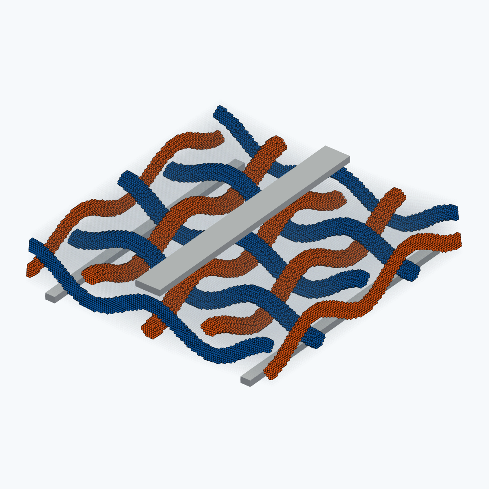 **woven-plain-transverse-bending** [Results](results/woven--plain--transverse-bending/summary.json) · [Video](images/woven-plain-transverse-bending.mp4) | 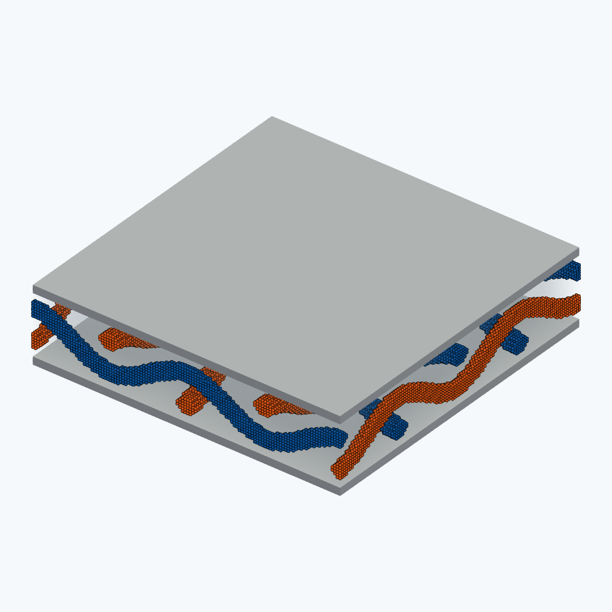 **woven-plain-transverse-compression** [Results](results/woven--plain--transverse-compression/summary.json) · [Video](images/woven-plain-transverse-compression.mp4) |  **woven-triaxial-in-plane-shear** [Results](results/woven--triaxial--in-plane-shear/summary.json) · [Video](images/woven-triaxial-in-plane-shear.mp4) |
|  **woven-plain-in-plane-shear** [Results](results/woven--plain--in-plane-shear/summary.json) · [Video](images/woven-plain-in-plane-shear.mp4) |  **woven-plain-warp-tension** [Results](results/woven--plain--warp-tension/summary.json) · [Video](images/woven-plain-warp-tension.mp4) | 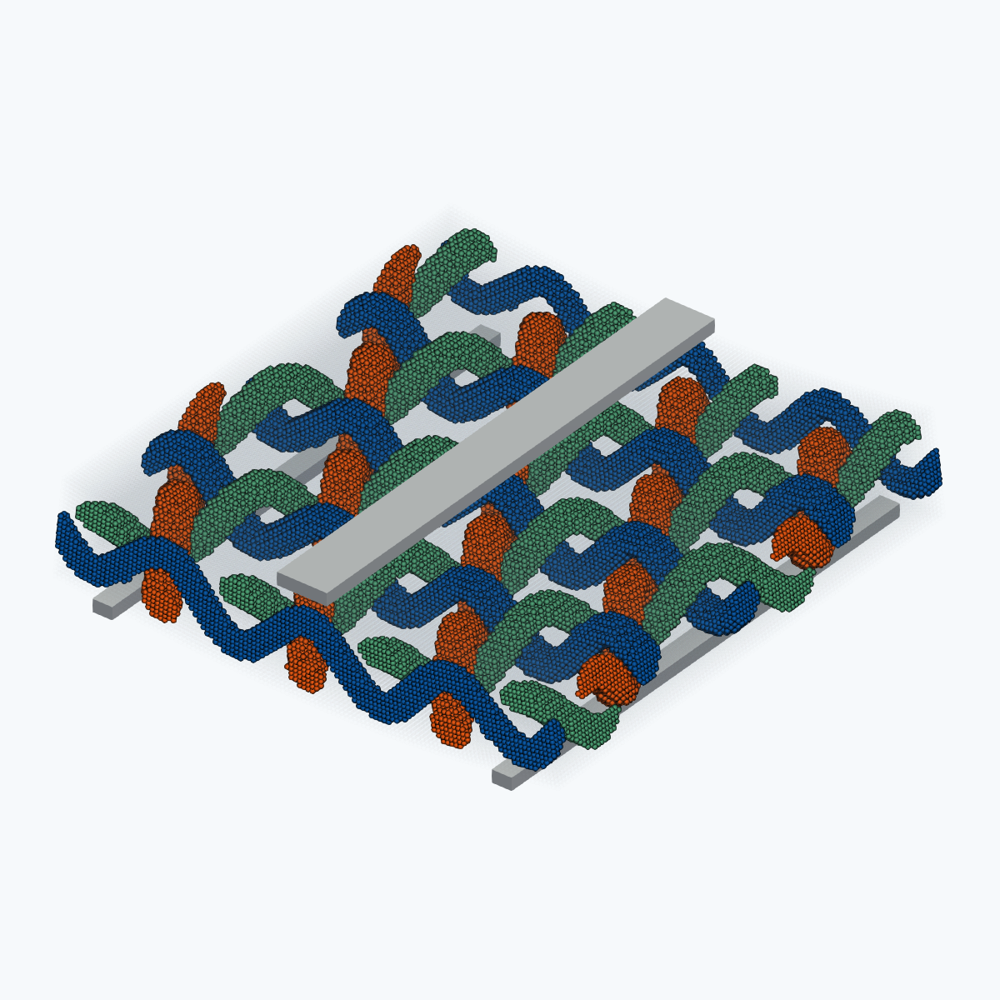 **woven-triaxial-transverse-bending** [Results](results/woven--triaxial--transverse-bending/summary.json) · [Video](images/woven-triaxial-transverse-bending.mp4) |
| 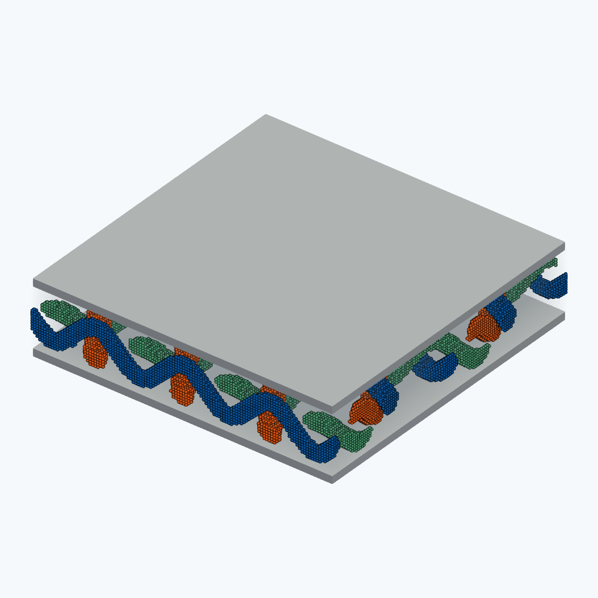 **woven-triaxial-transverse-compression** [Results](results/woven--triaxial--transverse-compression/summary.json) · [Video](images/woven-triaxial-transverse-compression.mp4) |  **woven-triaxial-warp-tension** [Results](results/woven--triaxial--warp-tension/summary.json) · [Video](images/woven-triaxial-warp-tension.mp4) |  **woven-triaxial-weft-tension** [Results](results/woven--triaxial--weft-tension/summary.json) · [Video](images/woven-triaxial-weft-tension.mp4) |
|  **woven-plain-weft-tension** [Results](results/woven--plain--weft-tension/summary.json) · [Video](images/woven-plain-weft-tension.mp4) |  **woven-twill-2x2-in-plane-shear** [Results](results/woven--twill-2x2--in-plane-shear/summary.json) · [Video](images/woven-twill-2x2-in-plane-shear.mp4) | 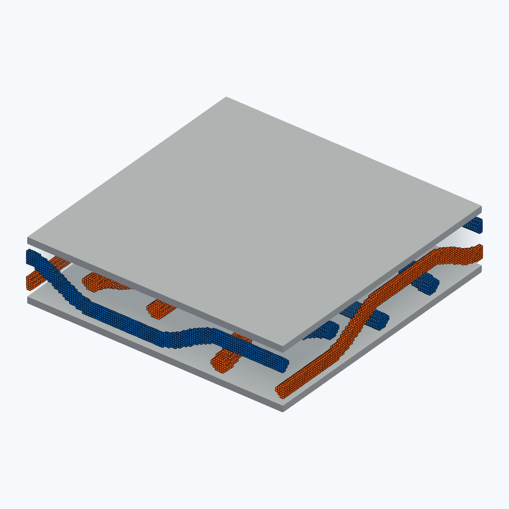 **woven-twill-2x2-transverse-compression** [Results](results/woven--twill-2x2--transverse-compression/summary.json) · [Video](images/woven-twill-2x2-transverse-compression.mp4) |
| 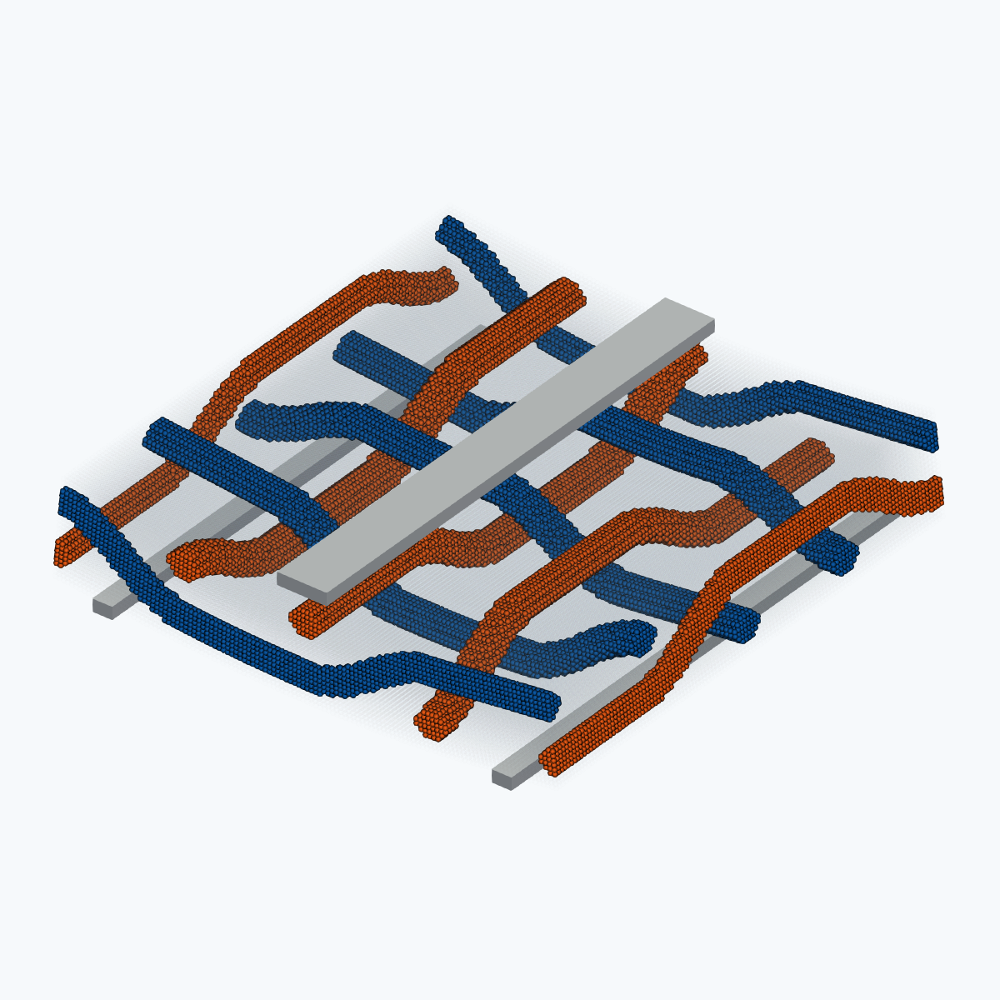 **woven-twill-2x2-transverse-bending** [Results](results/woven--twill-2x2--transverse-bending/summary.json) · [Video](images/woven-twill-2x2-transverse-bending.mp4) |  **woven-twill-2x2-warp-tension** [Results](results/woven--twill-2x2--warp-tension/summary.json) · [Video](images/woven-twill-2x2-warp-tension.mp4) |  **woven-twill-2x2-weft-tension** [Results](results/woven--twill-2x2--weft-tension/summary.json) · [Video](images/woven-twill-2x2-weft-tension.mp4) |
| 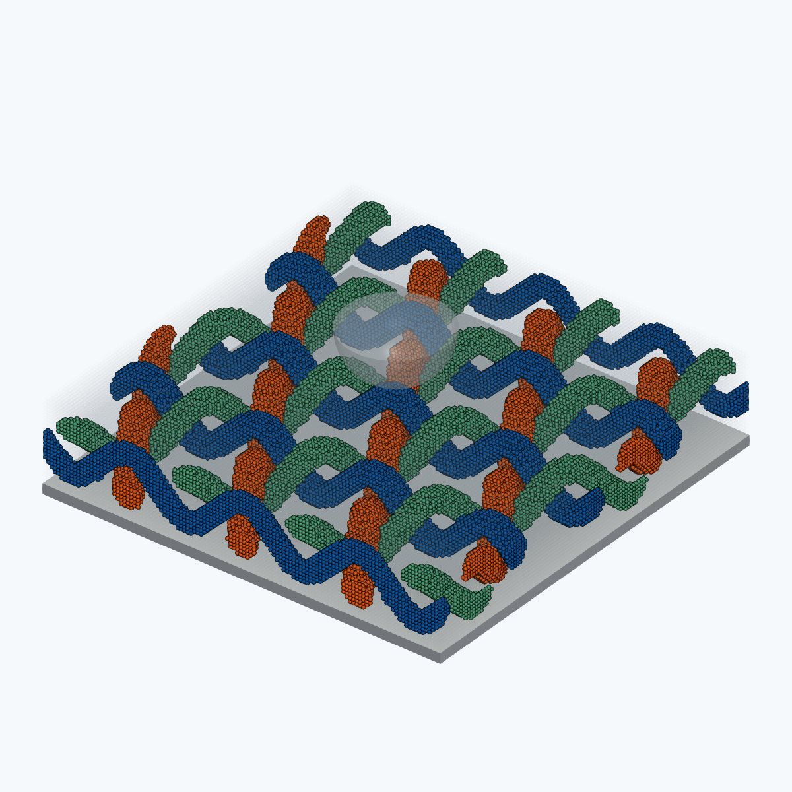 **woven-triaxial-hemispherical-compression** [Results](results/woven--triaxial--hemispherical-compression/summary.json) · [Video](images/woven-triaxial-hemispherical-compression.mp4) | 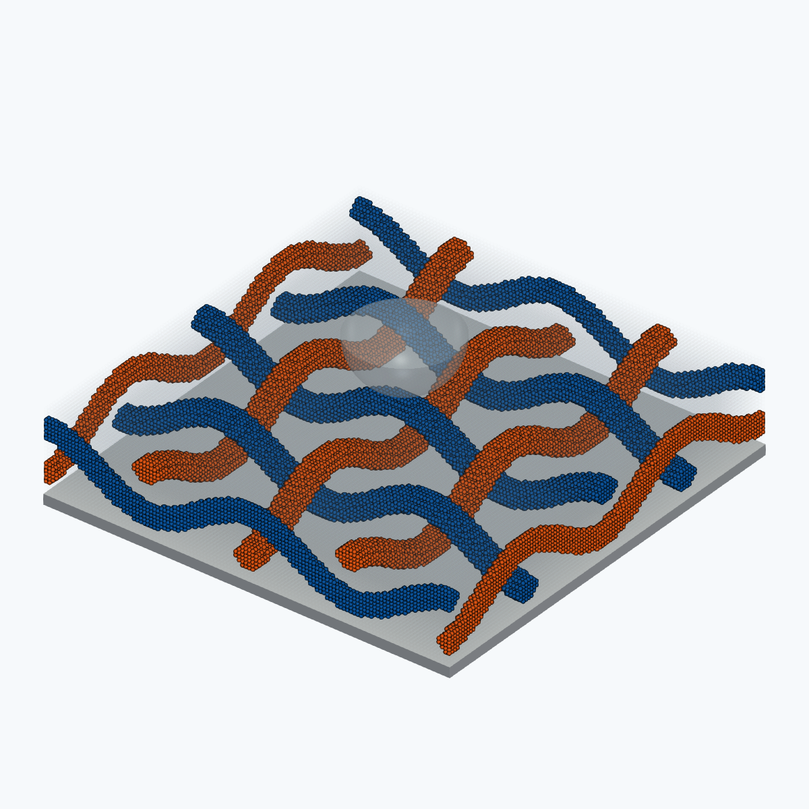 **woven-plain-hemispherical-compression** [Results](results/woven--plain--hemispherical-compression/summary.json) · [Video](images/woven-plain-hemispherical-compression.mp4) | 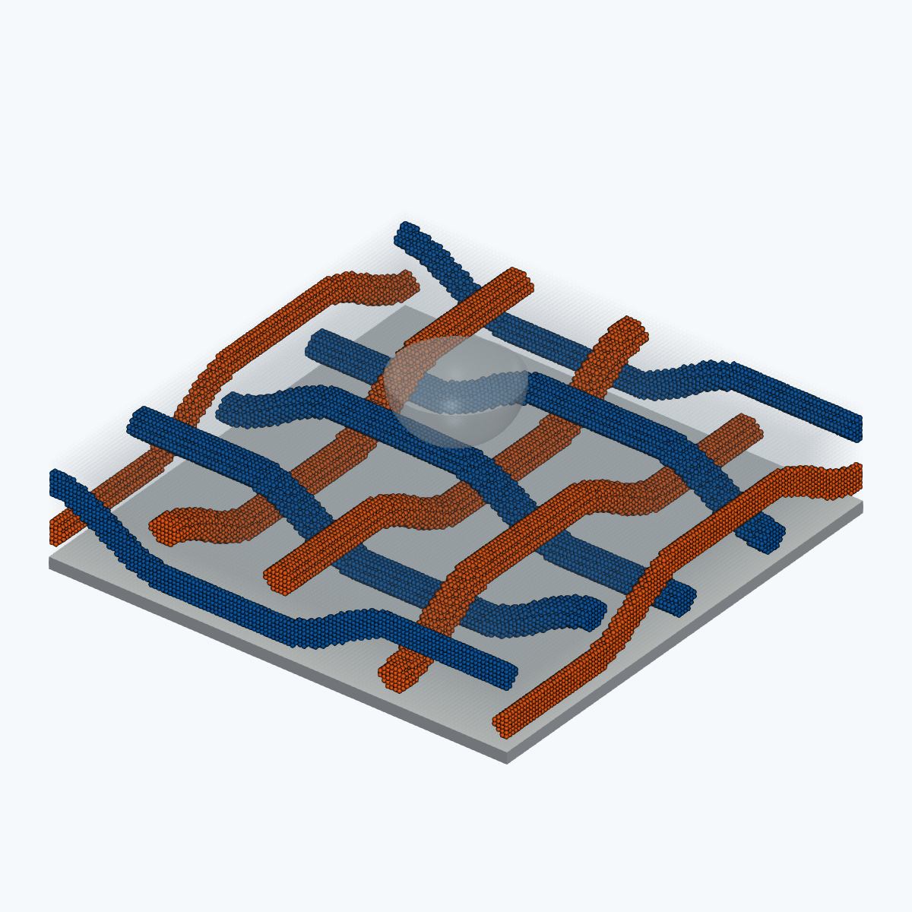 **woven-twill-2x2-hemispherical-compression** [Results](results/woven--twill-2x2--hemispherical-compression/summary.json) · [Video](images/woven-twill-2x2-hemispherical-compression.mp4) |

## Concrete bending with symmetry constraints

[Results](results/material-engineering--concrete-bending-symmetric--hjc/summary.json) · [Symmetry audit](results/material-engineering--concrete-bending-symmetric--hjc/runtime-symmetry.json) · [Video](images/concrete-bending-symmetric.mp4)

## Adhesion comparison

Matched contact views at the same withdrawal-hold time; physical geometry is unchanged.

| | |
|---|---|
|  **Nonadhesive pull-off** [Results](results/adhesion-visible--nonadhesive-pull-off/summary.json) · [Video](images/adhesion-visible-nonadhesive-pull-off.mp4) |  **Adhesive pull-off** [Results](results/adhesion-visible--adhesive-pull-off/summary.json) · [Video](images/adhesion-visible-adhesive-pull-off.mp4) |
