# Gallery

Selected ParaView frames and videos from completed runs. Every material point is rendered.
Body colours distinguish contacting bodies; the brittle-material compression
images show damage on a fixed range over time. [Run records](RESULTS.md) contain
the parameters and numerical results.

## Material engineering

| | |
|---|---|
| 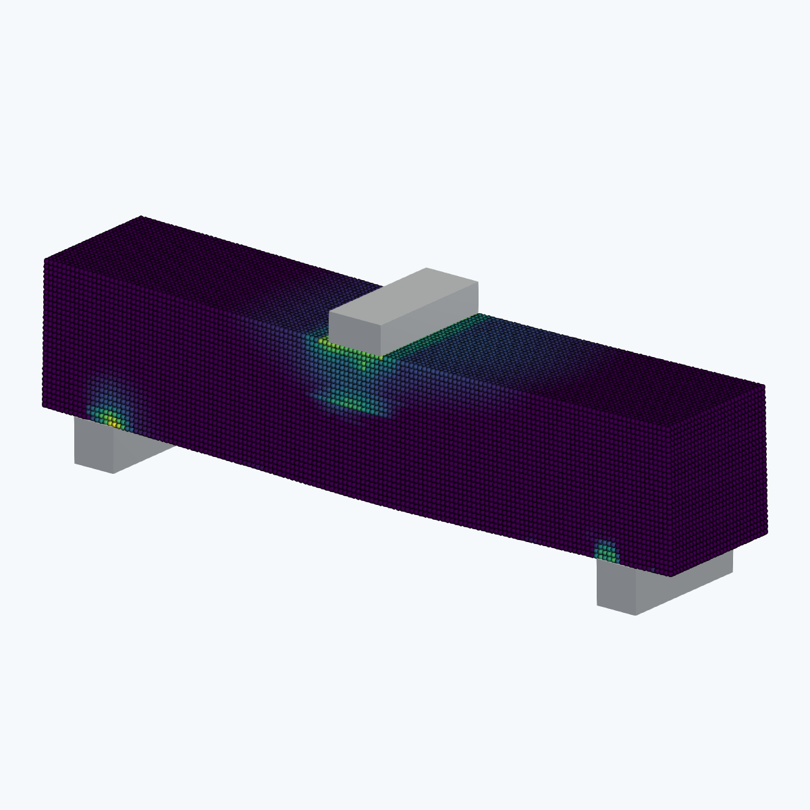 **concrete-bending** · 121,104 particles [Results](results/material-engineering--concrete-bending--hjc/summary.json) · [Video](images/concrete-bending.mp4) | 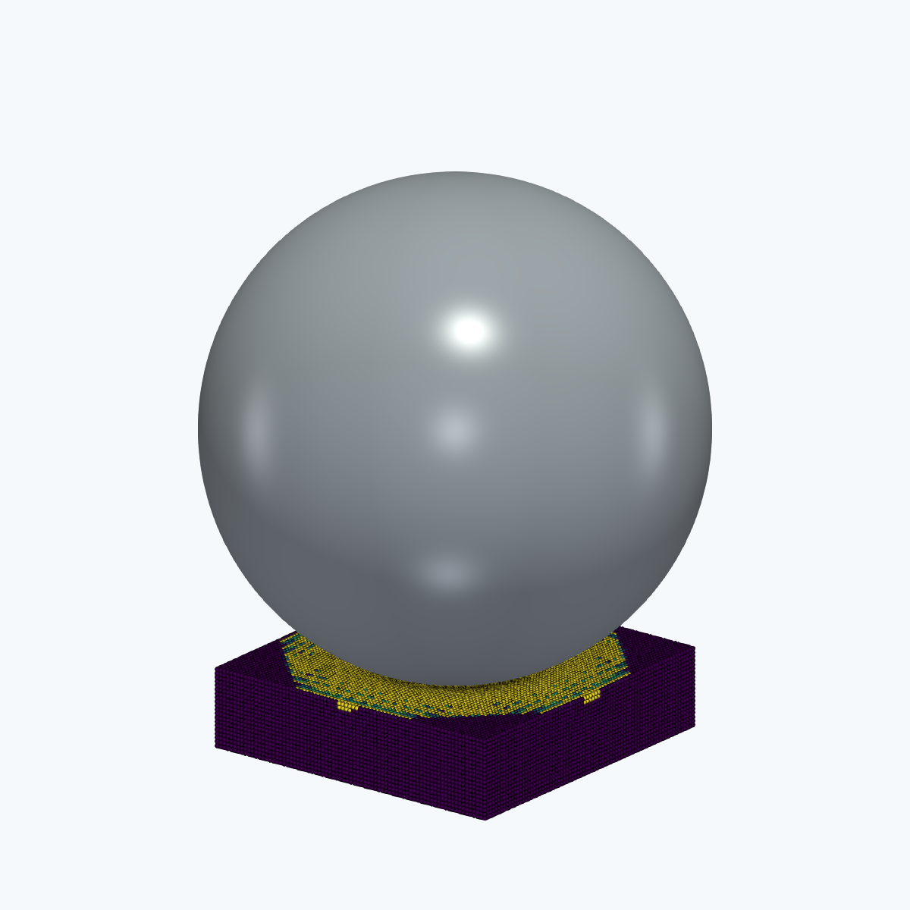 **ceramic-indentation** · 118,580 particles [Results](results/material-engineering--ceramic-indentation--jh2/summary.json) · [Video](images/ceramic-indentation.mp4) |

## Engineering structures and tanks

| | |
|---|---|
|  **perforated-panel** · 97,536 particles [Results](results/engineering--perforated-panel--neo-hookean/summary.json) · [Video](images/perforated-panel.mp4) |  **cellular-cushion** · 192,180 particles [Results](results/engineering--cellular-cushion--neo-hookean/summary.json) · [Video](images/cellular-cushion.mp4) |
|  **baffled-tank** · 363,352 particles [Results](results/engineering--baffled-tank--neo-hookean/summary.json) · [Video](images/baffled-tank.mp4) |  **unbaffled-tank** · 342,144 particles [Results](results/engineering--unbaffled-tank--neo-hookean/summary.json) · [Video](images/unbaffled-tank.mp4) |

## Dynamics and contact

| | |
|---|---|
|  **sphere-contact** · 386,019 particles [Results](results/contact-models--sphere-contact/summary.json) · [Video](images/sphere-contact.mp4) |  **jkr-footprint** · 386,019 particles [Results](results/contact-models--jkr-footprint/summary.json) · [Video](images/jkr-footprint.mp4) |
| 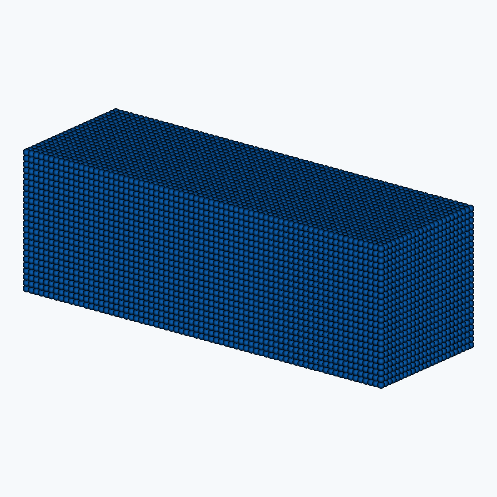 **wave** · 41,472 particles [Results](results/suite--wave--neo-hookean/summary.json) | 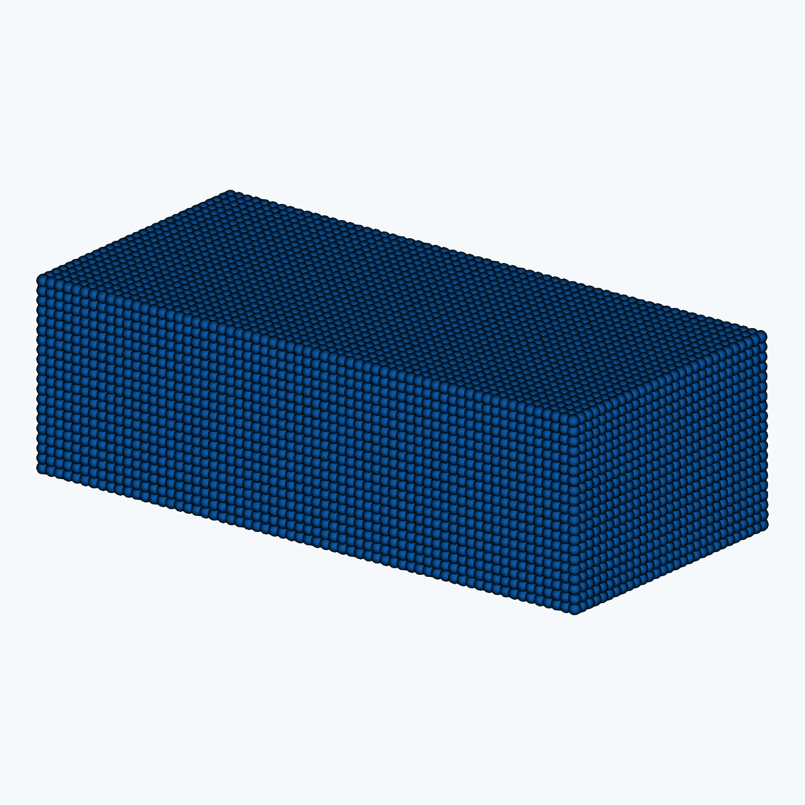 **cantilever** · 36,540 particles [Results](results/suite--cantilever--neo-hookean/summary.json) |
| 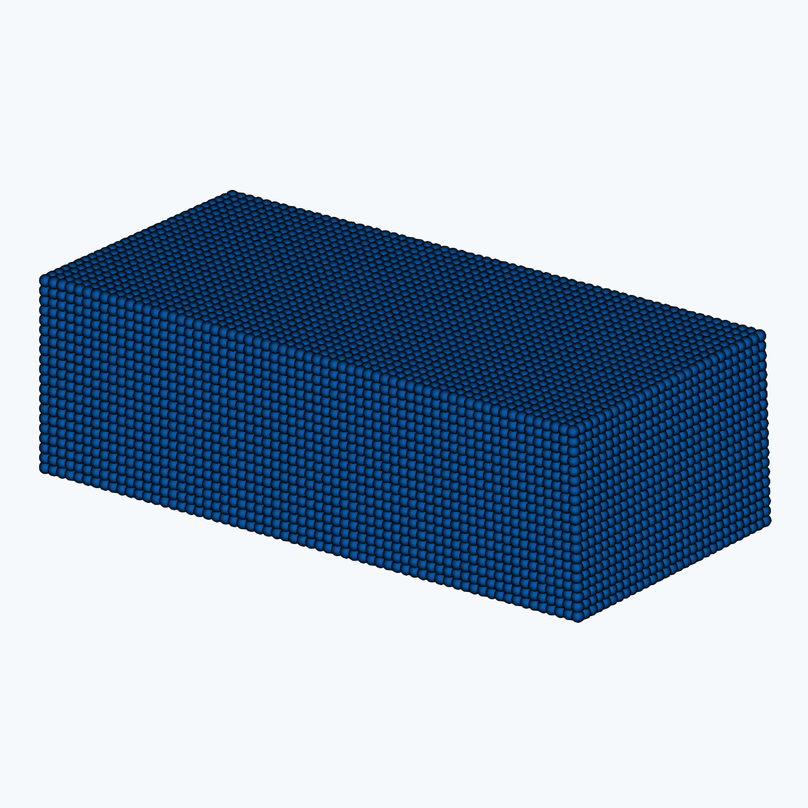 **torsion** · 36,540 particles [Results](results/suite--torsion--neo-hookean/summary.json) |  **oblique** · 38,686 particles [Results](results/suite--oblique--neo-hookean/summary.json) · [Video](images/oblique.mp4) |
|  **sliding** · 16,704 particles [Results](results/suite--sliding--neo-hookean/summary.json) |  **rebound** · 24,389 particles [Results](results/suite--rebound--neo-hookean/summary.json) |
|  **rubber-ball** · 44,720 particles [Results](results/benchmarks--rubber-ball--neo-hookean/summary.json) · [Video](images/rubber-ball.mp4) |  **ball-beam** · 88,583 particles [Results](results/benchmarks--ball-beam--neo-hookean/summary.json) · [Video](images/ball-beam.mp4) |
|  **large-bending** · 119,944 particles [Results](results/benchmarks--large-bending--neo-hookean/summary.json) · [Video](images/large-bending.mp4) |  **large-twist** · 119,944 particles [Results](results/benchmarks--large-twist--neo-hookean/summary.json) · [Video](images/large-twist.mp4) |

## Fluids and fluid–solid interaction

| | |
|---|---|
|  **dam-break** · 66,096 particles [Results](results/suite--dam-break--neo-hookean/summary.json) · [Video](images/dam-break.mp4) |  **sloshing** · 82,944 particles [Results](results/suite--sloshing--neo-hookean/summary.json) |
|  **fsi** · 85,776 particles [Results](results/suite--fsi--neo-hookean/summary.json) · [Video](images/fsi.mp4) |  **elastic-gate** · 357,912 particles [Results](results/benchmarks--elastic-gate--neo-hookean/summary.json) · [Video](images/elastic-gate.mp4) |
|  **floating-block** · 384,373 particles [Results](results/benchmarks--floating-block--neo-hookean/summary.json) · [Video](images/floating-block.mp4) |  **water-entry** · 1,327,400 particles [Results](results/production--water-entry--neo-hookean/summary.json) · [Video](images/water-entry.mp4) |

## Constitutive examples

| | |
|---|---|
| 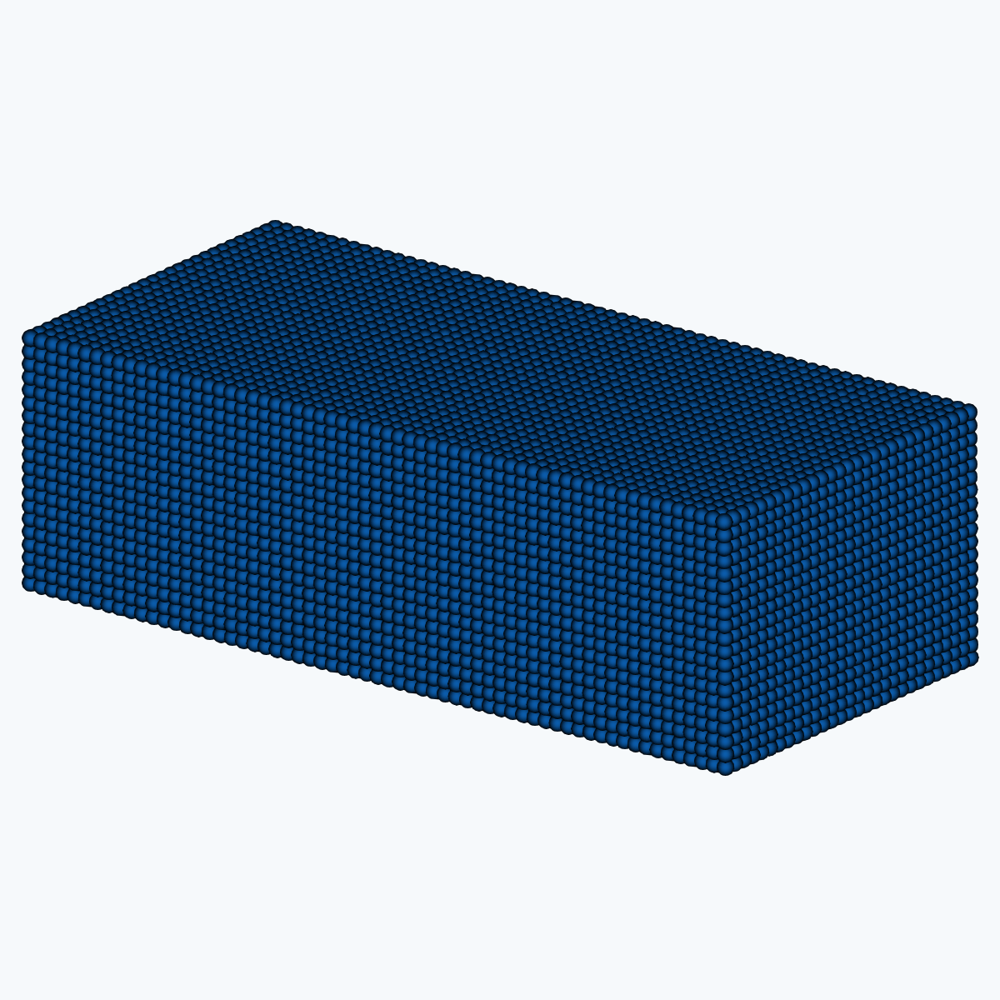 **orthotropic** · 36,540 particles [Results](results/elastic_cantilever--cantilever--orthotropic/summary.json) | 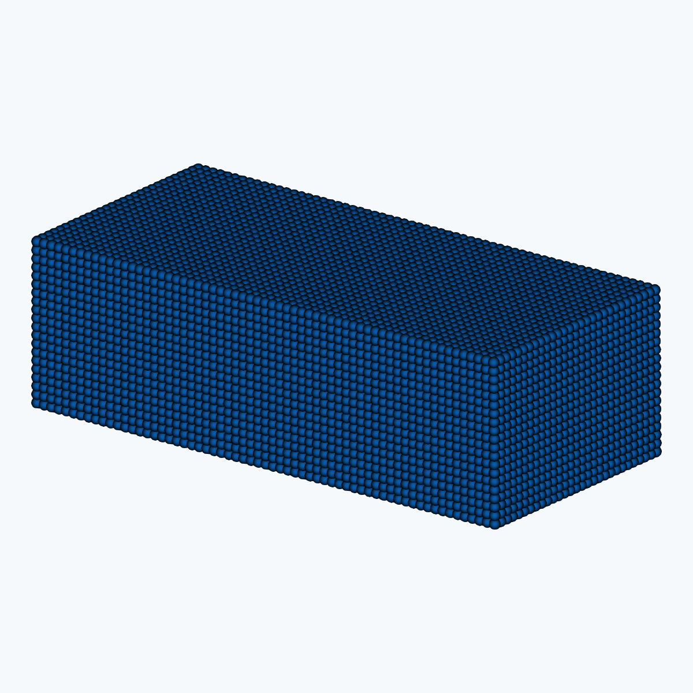 **transverse-isotropic** · 36,540 particles [Results](results/elastic_cantilever--cantilever--transverse-isotropic/summary.json) |
| 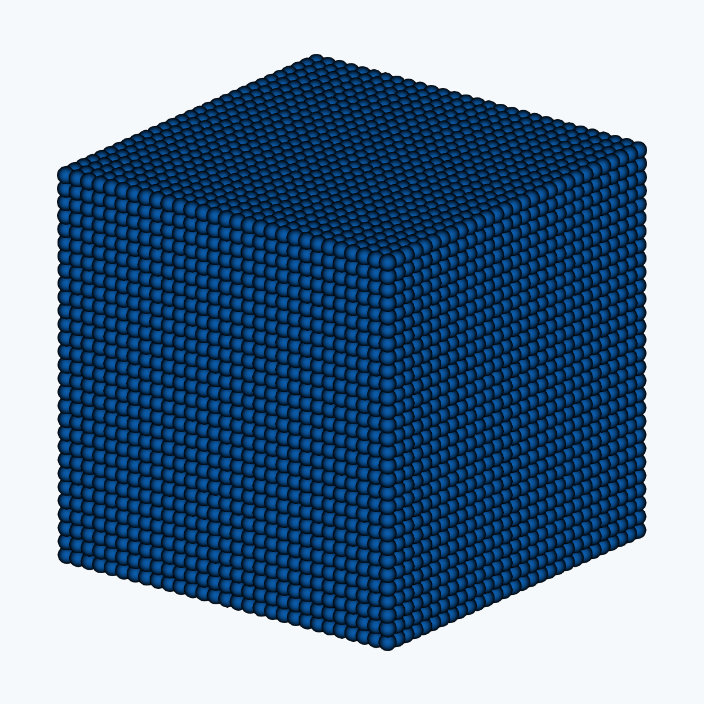 **johnson-cook** · 195,112 particles [Results](results/dense-materials--compression--johnson-cook/summary.json) · [Video](images/johnson-cook.mp4) | 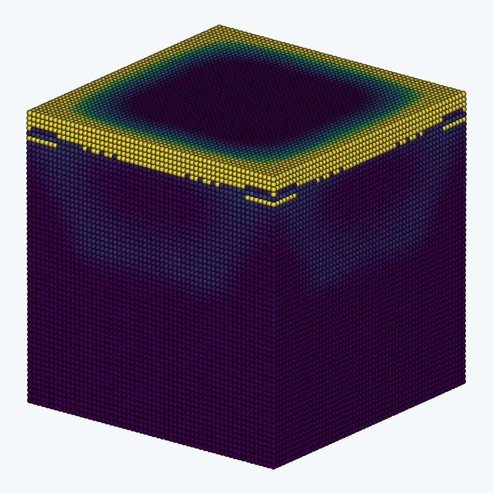 **jh2** · 195,112 particles [Results](results/dense-materials--compression--jh2/summary.json) · [Video](images/jh2.mp4) |
| 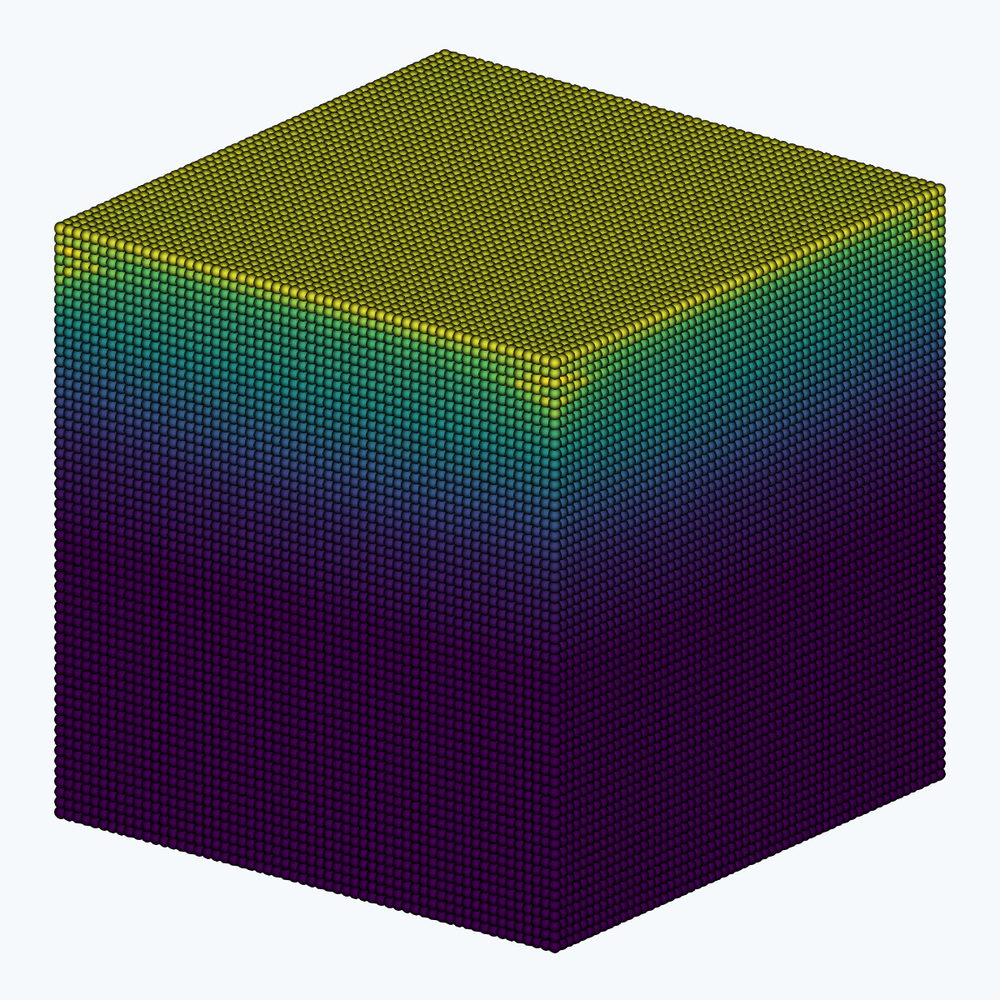 **hjc** · 195,112 particles [Results](results/dense-materials--compression--hjc/summary.json) · [Video](images/hjc.mp4) | 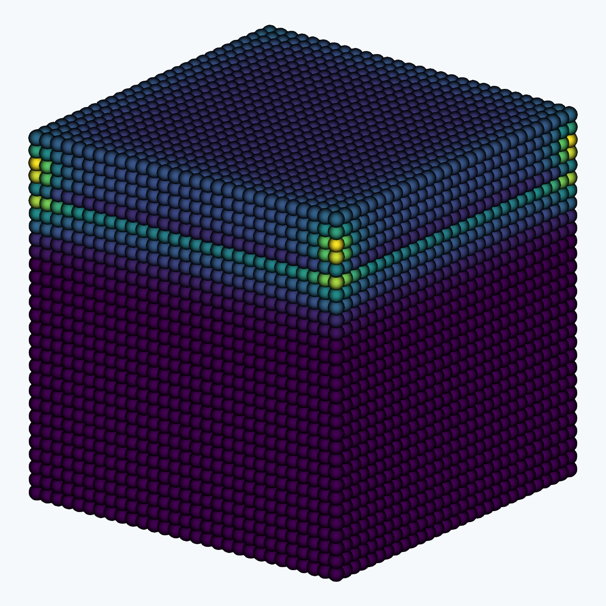 **rht** · 24,389 particles [Results](results/compression--compression--rht/summary.json) · [Video](images/rht.mp4) |
