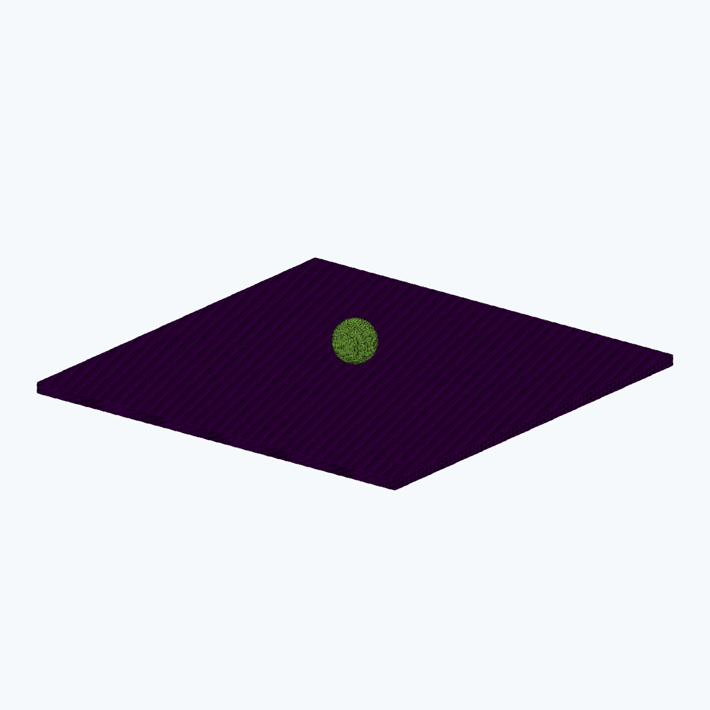

# Gallery

Selected ParaView frames and videos from completed runs. Every material point is rendered.
Body colours distinguish contacting bodies; damage colours use a fixed range
over time. [Run records](RESULTS.md) contain
the parameters and numerical results.

## Metals and high-speed impact

<table width="100%">
<tr>
<td width="33%" align="center"> <strong>jc-tension</strong> · 146,880 particles <a href="results/material-engineering--jc-tension--johnson-cook/summary.json">Results</a> · <a href="images/jc-tension.mp4">Video</a></td>
<td width="33%" align="center"> <a href="stages/metal-impact-f16/README.md">Metal impact: f16 numerical stage</a> 17 saved states; phase/EOS extrapolation. Not validated 5 km/s physics or a completed protocol.</td>
<td width="33%" align="center"></td>
</tr>
</table>

## Concrete and ceramics

<table width="100%">
<tr>
<td width="33%" align="center"> <strong>JH2 ceramic impact and debris</strong> · 386,420 particles <a href="results/completed--ceramic-impact-debris/summary.json">Results</a> · <a href="images/home/completed--ceramic-impact-debris.gif">GIF</a></td>
<td width="33%" align="center"> <strong>Concrete bending with symmetry constraints</strong> <a href="results/material-engineering--concrete-bending-symmetric--hjc/summary.json">Results</a> · <a href="results/material-engineering--concrete-bending-symmetric--hjc/runtime-symmetry.json">Symmetry audit</a> · <a href="images/concrete-bending-symmetric.mp4">Video</a></td>
<td width="33%" align="center"> <a href="views/ceramic-cross-section/README.md">JH2 ceramic central cross section</a> Same 61-state result; ballistic failed-particle debris.</td>
</tr>
</table>

## Woven composites

<table width="100%">
<tr>
<td width="33%" align="center"> <strong>woven-plain-in-plane-shear</strong> <a href="results/woven--plain--in-plane-shear/summary.json">Results</a> · <a href="images/woven-plain-in-plane-shear.mp4">Video</a></td>
<td width="33%" align="center"> <strong>woven-plain-warp-tension</strong> <a href="results/woven--plain--warp-tension/summary.json">Results</a> · <a href="images/woven-plain-warp-tension.mp4">Video</a></td>
<td width="33%" align="center"> <strong>woven-plain-weft-tension</strong> <a href="results/woven--plain--weft-tension/summary.json">Results</a> · <a href="images/woven-plain-weft-tension.mp4">Video</a></td>
</tr>
<tr>
<td width="33%" align="center"> <strong>Clamped woven plate impact</strong> · 819,200 particles <a href="results/completed--woven-plate-impact/summary.json">Results</a> · <a href="images/home/completed--woven-plate-impact.gif">GIF</a> · <a href="images/woven-plate-impact.mp4">Video</a></td>
<td width="33%" align="center"> <strong>woven-triaxial-in-plane-shear</strong> <a href="results/woven--triaxial--in-plane-shear/summary.json">Results</a> · <a href="images/woven-triaxial-in-plane-shear.mp4">Video</a></td>
<td width="33%" align="center"> <strong>woven-triaxial-warp-tension</strong> <a href="results/woven--triaxial--warp-tension/summary.json">Results</a> · <a href="images/woven-triaxial-warp-tension.mp4">Video</a></td>
</tr>
<tr>
<td width="33%" align="center"> <strong>woven-triaxial-weft-tension</strong> <a href="results/woven--triaxial--weft-tension/summary.json">Results</a> · <a href="images/woven-triaxial-weft-tension.mp4">Video</a></td>
<td width="33%" align="center"> <strong>woven-twill-2x2-in-plane-shear</strong> <a href="results/woven--twill-2x2--in-plane-shear/summary.json">Results</a> · <a href="images/woven-twill-2x2-in-plane-shear.mp4">Video</a></td>
<td width="33%" align="center"> <strong>woven-twill-2x2-warp-tension</strong> <a href="results/woven--twill-2x2--warp-tension/summary.json">Results</a> · <a href="images/woven-twill-2x2-warp-tension.mp4">Video</a></td>
</tr>
<tr>
<td width="33%" align="center"> <strong>woven-twill-2x2-weft-tension</strong> <a href="results/woven--twill-2x2--weft-tension/summary.json">Results</a> · <a href="images/woven-twill-2x2-weft-tension.mp4">Video</a></td>
<td width="33%" align="center"></td>
<td width="33%" align="center"></td>
</tr>
</table>

## Adhesion and contact

<table width="100%">
<tr>
<td width="33%" align="center"> <strong>Nonadhesive pull-off</strong> <a href="results/adhesion-visible--nonadhesive-pull-off/summary.json">Results</a> · <a href="images/adhesion-visible-nonadhesive-pull-off.mp4">Video</a></td>
<td width="33%" align="center"> <strong>Adhesive pull-off</strong> <a href="results/adhesion-visible--adhesive-pull-off/summary.json">Results</a> · <a href="images/adhesion-visible-adhesive-pull-off.mp4">Video</a></td>
<td width="33%" align="center"> <strong>adhesion-lateral-release</strong> · 367,744 particles <a href="results/adhesion--lateral-release/summary.json">Results</a> · <a href="images/adhesion-lateral-release.mp4">Video</a></td>
</tr>
<tr>
<td width="33%" align="center"> <strong>adhesion-three-sphere-array</strong> · 367,744 particles <a href="results/adhesion--three-sphere-array/summary.json">Results</a> · <a href="images/adhesion-three-sphere-array.mp4">Video</a></td>
<td width="33%" align="center"> <strong>ball-beam</strong> · 88,583 particles <a href="results/benchmarks--ball-beam--neo-hookean/summary.json">Results</a> · <a href="images/ball-beam.mp4">Video</a></td>
<td width="33%" align="center"> <strong>Crossed fibre Hertz contact</strong> · 202,240 particles <a href="results/completed--crossed-fibre-hertz/summary.json">Results</a> · <a href="images/home/completed--crossed-fibre-hertz.gif">GIF</a></td>
</tr>
<tr>
<td width="33%" align="center"> <strong>jkr-footprint</strong> · 386,019 particles <a href="results/contact-models--jkr-footprint/summary.json">Results</a> · <a href="images/jkr-footprint.mp4">Video</a></td>
<td width="33%" align="center"> <strong>oblique</strong> · 38,686 particles <a href="results/suite--oblique--neo-hookean/summary.json">Results</a> · <a href="images/oblique.mp4">Video</a></td>
<td width="33%" align="center"> <strong>rebound</strong> · 24,389 particles <a href="results/suite--rebound--neo-hookean/summary.json">Results</a></td>
</tr>
<tr>
<td width="33%" align="center"> <strong>rubber-ball</strong> · 44,720 particles <a href="results/benchmarks--rubber-ball--neo-hookean/summary.json">Results</a> · <a href="images/rubber-ball.mp4">Video</a></td>
<td width="33%" align="center"> <strong>sliding</strong> · 16,704 particles <a href="results/suite--sliding--neo-hookean/summary.json">Results</a></td>
<td width="33%" align="center"> <strong>sphere-contact</strong> · 386,019 particles <a href="results/contact-models--sphere-contact/summary.json">Results</a> · <a href="images/sphere-contact.mp4">Video</a></td>
</tr>
</table>

## Fluids and fluid-solid interaction

<table width="100%">
<tr>
<td width="33%" align="center"> <strong>baffled-tank</strong> · 363,352 particles <a href="results/engineering--baffled-tank--neo-hookean/summary.json">Results</a> · <a href="images/baffled-tank.mp4">Video</a></td>
<td width="33%" align="center"> <strong>dam-break</strong> · 66,096 particles <a href="results/suite--dam-break--neo-hookean/summary.json">Results</a> · <a href="images/dam-break.mp4">Video</a></td>
<td width="33%" align="center"> <strong>elastic-gate</strong> · 357,912 particles <a href="results/benchmarks--elastic-gate--neo-hookean/summary.json">Results</a> · <a href="images/elastic-gate.mp4">Video</a></td>
</tr>
<tr>
<td width="33%" align="center"> <strong>floating-block</strong> · 384,373 particles <a href="results/benchmarks--floating-block--neo-hookean/summary.json">Results</a> · <a href="images/floating-block.mp4">Video</a></td>
<td width="33%" align="center"> <strong>fsi</strong> · 85,776 particles <a href="results/suite--fsi--neo-hookean/summary.json">Results</a> · <a href="images/fsi.mp4">Video</a></td>
<td width="33%" align="center"> <strong>sloshing</strong> · 82,944 particles <a href="results/suite--sloshing--neo-hookean/summary.json">Results</a></td>
</tr>
<tr>
<td width="33%" align="center"> <strong>unbaffled-tank</strong> · 342,144 particles <a href="results/engineering--unbaffled-tank--neo-hookean/summary.json">Results</a> · <a href="images/unbaffled-tank.mp4">Video</a></td>
<td width="33%" align="center"> <strong>water-entry</strong> · 1,327,400 particles <a href="results/production--water-entry--neo-hookean/summary.json">Results</a> · <a href="images/water-entry.mp4">Video</a></td>
<td width="33%" align="center"></td>
</tr>
</table>

## Structural elasticity

<table width="100%">
<tr>
<td width="33%" align="center"> <strong>cellular-cushion</strong> · 192,180 particles <a href="results/engineering--cellular-cushion--neo-hookean/summary.json">Results</a> · <a href="images/cellular-cushion.mp4">Video</a></td>
<td width="33%" align="center"> <strong>large-bending</strong> · 119,944 particles <a href="results/benchmarks--large-bending--neo-hookean/summary.json">Results</a> · <a href="images/large-bending.mp4">Video</a></td>
<td width="33%" align="center"> <strong>large-twist</strong> · 119,944 particles <a href="results/benchmarks--large-twist--neo-hookean/summary.json">Results</a> · <a href="images/large-twist.mp4">Video</a></td>
</tr>
<tr>
<td width="33%" align="center"> <strong>perforated-panel</strong> · 97,536 particles <a href="results/engineering--perforated-panel--neo-hookean/summary.json">Results</a> · <a href="images/perforated-panel.mp4">Video</a></td>
<td width="33%" align="center"> <strong>visible-cantilever</strong> · 119,944 particles <a href="results/visible-motion--cantilever--neo-hookean/summary.json">Results</a> · <a href="images/visible-cantilever.mp4">Video</a></td>
<td width="33%" align="center"> <strong>visible-shear</strong> · 242,208 particles <a href="results/visible-motion--shear--neo-hookean/summary.json">Results</a> · <a href="images/visible-shear.mp4">Video</a></td>
</tr>
<tr>
<td width="33%" align="center"> <strong>visible-surface-load</strong> · 113,535 particles <a href="results/visible-motion--surface-load--neo-hookean/summary.json">Results</a> · <a href="images/visible-surface-load.mp4">Video</a></td>
<td width="33%" align="center"> <strong>visible-torsion</strong> · 119,944 particles <a href="results/visible-motion--torsion--neo-hookean/summary.json">Results</a> · <a href="images/visible-torsion.mp4">Video</a></td>
<td width="33%" align="center"></td>
</tr>
</table>
