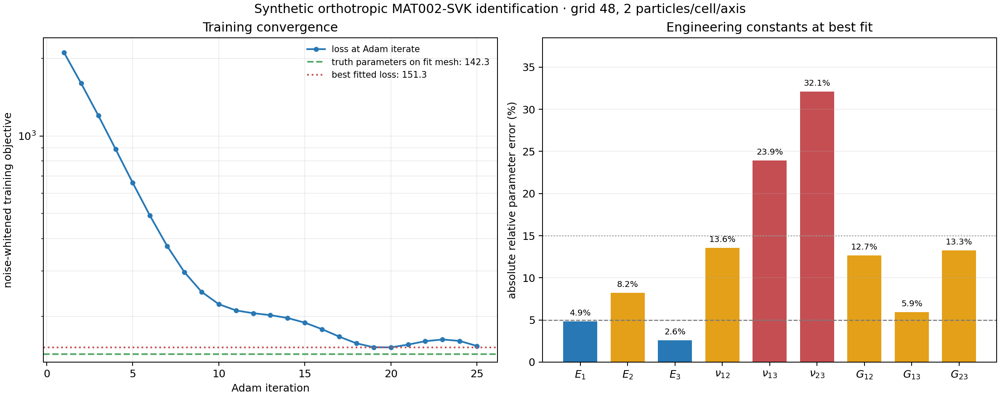
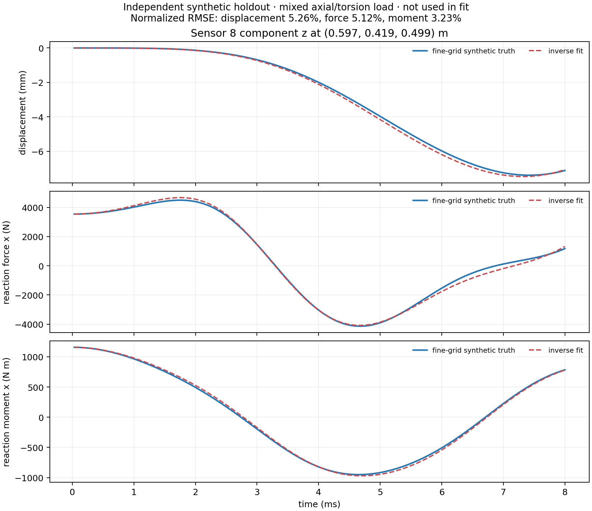

# Multi-parameter orthotropic MPM inversion

Run from the repository root:

```powershell
python -m examples.inverse_orthotropic_svk --output results/inverse-orthotropic-demo
```

This is a three-dimensional inverse problem using the released MAT002
orthotropic St. Venant–Kirchhoff energy and the reference-grid total-Lagrangian
MPM velocity-Verlet solver. It does not differentiate through a damage or
plastic return map. The density is fixed at 1050 kg/m³.

## Parameters and positive definiteness

The fit identifies nine independent elastic constants: E1, E2, E3, nu12,
nu13, nu23, G12, G13, G23. They are reported in engineering form. During
optimization they are represented as six parameters for the lower triangular
Cholesky factor of the 3 by 3 normal stiffness block and three log-bounded
positive shear moduli. The normal block is L Lᵀ, so every optimizer iterate
has positive-definite normal stiffness; all three shear moduli remain positive.
The script converts the fitted stiffness back to engineering constants through
its compliance matrix and records the transformed covariance/correlation
matrix. The parameterization is nine-dimensional, not nine unconstrained
entries of a general 6 by 6 matrix.

The fixed synthetic truth is E=(1.20, 0.80, 0.60) MPa,
nu=(0.22, 0.18, 0.25), and G=(0.42, 0.34, 0.26) MPa. The initial guess is
separately disclosed in `result.json`.

## Training experiments and observations

Eight prescribed fixture histories are fitted jointly: tension along each of
the three material axes; simple shear in the xy, xz, and yz planes; three-point
bending; and torsion around x. Each history starts and ends at rest. At every
time step the inverse uses all three displacement components at 12 marked
material points, the moving fixture reaction force, and its reaction moment.
The measured reaction is computed from the constrained nodal inertia minus
internal force, including the prescribed fixture acceleration.

The training data are labeled synthetic. The balanced training block occupies
0.40 × 0.30 × 0.25 m in a 1 m reference domain. The inverse defaults to a
36-cell grid and nominal 1.6 particles per cell per axis (5,474 particles,
with particle counts rounded per body axis); the thinnest direction spans 9
background cells. Training truth uses a 48-cell grid and 3 particles per cell
per axis (89,784 particles), with 12 background cells across the thickness.
Thus the forward/inverse difference includes background-grid resolution, not
only particle count. Fixed-seed Gaussian noise is
added independently to displacement, force, and moment channels at 0.3% of
each field's truth RMS (with a small numerical floor); exact standard
deviations and seed are saved with the observations.

A separate mixed axial/torsion case uses a 0.36 × 0.28 × 0.25 m block, a
48-cell grid, 3 particles per cell per axis (74,880 particles), a 32 μs
step, and 250 steps. It uses a sensor set disjoint from training and is not
included in the objective. This independently checks changed geometry,
sensor locations, time step, and load combination at the fine grid. Sensors
are placed at least 10 mm inside the free region after the clamp band, leaving
about 30% of the block volume unclamped for observation. Its full displacement,
force, and moment histories are saved for a forward prediction check.

## Differentiation and identifiability

`jax.lax.scan` advances actual MPM time steps. `jax.checkpoint` rematerializes
each MPM step and each complete loading case in reverse mode. A sequential
`jax.lax.map` reduces each case to its three scalar channel losses before
advancing, avoiding a stack of all eight time-history arrays in the gradient
graph while preserving the same global mean-square objective. A small `jax.vmap` interpolates the
marked sensor points within each step. Large reference-grid and boundary data
are explicit JIT inputs; prescribed motion is stored as a spatial pattern and
three compact scalar phase histories, then assembled during the scan. A jitted
`jax.value_and_grad` drives Adam. Before optimization the CLI compares one
random directional AD derivative with a central finite difference. At the fitted
point it builds the noise-whitened response Jacobian, reports its singular
values/rank/condition number, and calculates the local engineering-constant
correlation matrix from the Fisher information pseudoinverse. These are local
linearized diagnostics, not global confidence bounds. A deficient rank or
strong correlations must be reported as remaining non-identifiability.

## Recorded multi-parameter qualification (2026-10-27)

The compact review bundle in [`evidence/orthotropic_inverse_20261027`](../evidence/orthotropic_inverse_20261027/README.md)
contains the result JSON, final best checkpoint, loss history, computed holdout
histories, resource receipts, and SHA-256 manifest. The recorded fit used a
custom grid-48, ppc-2 inverse discretization (26,448 particles) against the
frozen synthetic observations generated at grid-48, ppc-3 (89,784 particles).
The exact frozen training archive is included at
`evidence/orthotropic_inverse_20261027/training_synthetic.npz` (979,207 bytes,
SHA-256 `022e915e098b3212439167c0496c3e555a58318a4d337971d2deb802ee2b4269`)
and its digest is recorded in the evidence manifest.
These two runs share the same 48-cell background grid; the difference is
particle quadrature. The true-parameter loss on the fit discretization was
142.265 and the best loss was 151.339 after 25 Adam iterations.

The final best engineering constants have absolute relative errors of 4.9%,
8.2%, and 2.6% for E1–E3; 12.7%, 5.9%, and 13.3% for G12, G13, and G23; and
13.6%, 23.9%, and 32.1% for nu12, nu13, and nu23. Although the local
noise-whitened Jacobian is full rank (9/9, condition number 4.40), these errors
show that the nine constants were not recovered exactly. The run reports the
bias rather than interpreting full local rank as accurate identification.

The independent grid-48 / ppc-3 mixed axial/torsion holdout uses 74,880
particles, a different specimen size, 250 steps at 32 μs, and a disjoint sensor
set. Its normalized RMSE relative to the synthetic truth RMS is 5.26% for
sensor displacement, 5.12% for reaction force, and 3.23% for reaction moment.
The evidence bundle includes histories and two figures; the plotted curves use
computed time samples directly. No particle snapshots were saved, so the
figures are response plots, not ParaView particle-motion renders.

A separate final-checkpoint directional AD/central-FD audit used the same
frozen observations and grid-48 / ppc-2 fit objective. Its relative error was
2.82 × 10⁻⁸ at epsilon 2 × 10⁻⁴. The direction and all fit, checkpoint, and
observation hashes are saved in `gradient_check.json`.





## Resolution and resources

Defaults are 200 time steps and 35 optimizer iterations. The loss receipt
also reports the fit-discretization response loss at the known synthetic truth
constants; this separates optimization error from the declared particle and
background-grid discrepancy. Training spans 8 ms at 40 μs per step. At the disclosed truth
stiffness, the largest normal-block acoustic speed is about 37.1 m/s; for the
48-cell truth grid the estimate `0.1 dx/c` is about 56 μs, so the chosen step
is about 0.71 of that estimate. The fastest wave travels about 0.30 m during
training. Clamp regions are fixed relative to the specimen's physical faces,
with a 47.5 mm thickness on both meshes, instead of being measured from each
mesh's outermost occupied node. The CLI records mass-bearing support and
driven node counts, masses, volumes, overlap, and spatial extents for each
fixture on both meshes. Training sensors are shared physical reference
coordinates and remain outside the clamp bands; about 32% of the training
block volume remains outside the clamp bands. The reference-grid stencil
has 27 nodes per particle; 89,784 particles require about 62 MiB each for
float64 gradients or weights before other state, batched
cases, JAX buffers, or compiler memory. `--grid`, `--ppc`,
`--truth-grid`, `--truth-ppc`, `--steps`, `--iterations`, and `--dt` control
this cost. A remote qualification uses 4 CPUs, a 12 GiB container memory
limit, a 9 GiB process USS guard, and a bounded time window. The result records
measured runtime and process peak RSS when exposed by the runtime; it does not
infer device memory from array sizes.

The CLI writes `result.json`, `loss_history.csv`, `checkpoint.npz`,
`checkpoint_ready.json`, `training_synthetic.npz`, and `holdout_synthetic.npz`,
including source hashes and loading fixture receipts. The frozen training
archive is written before optimization, and the checkpoint and its receipt
are refreshed after every optimizer step, so a bounded run can resume without
regenerating the high-resolution synthetic histories.

For a continuation, pass a previously saved training archive and optimizer
checkpoint with their SHA-256 digests using `--training-observations`,
`--observations-sha256`, `--training-result`, `--training-result-sha256`,
`--initial-checkpoint`, and `--checkpoint-sha256`. The CLI verifies the saved
case names, time axis, truth constants, grid controls, and checkpoint loss,
then resumes Adam at the stored iteration. It does not regenerate or perturb
the frozen training observations. The result records the observation and
checkpoint hashes and the loss at the true constants on the fit discretization,
which helps separate optimization error from discretization discrepancy.

When a checkpoint receipt does not contain an already passed derivative audit,
`--resume-diagnostics PATH --resume-diagnostics-sha256 SHA256` can reuse a
separate diagnostic receipt. The CLI checks that receipt against the exact
observation, prior result, checkpoint, mesh/time controls, and unchanged MPM
physics-module hashes before skipping repeated initialization/true-parameter/
directional-FD calculations. Otherwise it performs those calculations again.
