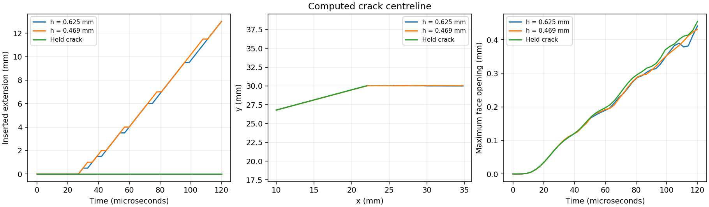

# Advected cracks and stress-selected turning

A tilted edge crack opens under vertical tension and turns toward a nearly
horizontal path. The crack faces move with the material. New segments are
selected from the computed stress; their coordinates are not prescribed.
This is an experimental strength-driven branch. It does not yet combine
turning with the fracture-energy control of the [cohesive solver](COHESIVE_DCB.md).
The subsequent [extrinsic cohesive branch](EXTRINSIC_CRACK.md) adds birth
traction, fracture-energy control and an insertion-energy ledger.

<table width="100%">
<tr>
<td width="50%" align="center"><br>Inclined edge crack</td>
<td width="50%" align="center"><br>Turning detail</td>
</tr>
</table>

## Transfer and insertion

The [JAX implementation](../mpm_jax/polyline_crack.py) independently extends
the explicit-path and split-velocity-field ideas of
[mpm-fracture](https://github.com/titoadibaskoro/mpm-fracture).
Particle–node links use intersection parity. A half-open intersection rule
counts shared vertices once and distinguishes a crossing from a tangency.
Nodes exactly on a crack receive a consistent left-side tie break.

Two face-marker arrays follow their own velocity fields; their mean defines
the geometric centreline. The tip remains a shared point until another segment
is inserted. The mouth's visibility segment extends through exterior support
nodes, preventing a connection through empty space. There is no nodal exchange
between opening faces, particle deletion or imposed opening displacement.

The tip averages Cauchy stress over a forward half-disc of fixed physical
radius 1.5 mm, with reference-volume weights proportional to `(1-r²/R²)²`.
The candidate tangent is perpendicular to the largest tensile principal-stress
direction, oriented forward and limited to a 45° turn per insertion.
The traction on that candidate plane drives
`v = vmax * max(1 - strength / traction, 0)`.
These are explicit modelling choices, not a calibrated mixed-mode fracture law.

Travel accumulates until 0.5 mm is available, then a full segment is inserted.
The numerical crack therefore advances in discrete increments; pending travel
is recorded separately. Inserting an arbitrarily short segment failed a mesh
check: its direction was dominated by differences in face-marker advection.
The earlier algorithm gave 13.212 mm extension on the coarser grid and only
0.283 mm on the finer grid. Those trajectories are rejected. The retained
algorithm uses a finite insertion length on both meshes. Insertion into an
existing segment or exhaustion of the path buffer invalidates the run.

## Opening case and controls

The plate is 40 × 20 mm in plane strain. Its initial edge crack has a 12 mm
horizontal projection and a 15° inclination. The material is neo-Hookean,
with Young's modulus 3 GPa, Poisson's ratio 0.2 and density 1200 kg/m³.
Upper and lower grip strips move vertically at opposing 2 m/s velocities
after a 20 µs half-cosine ramp; horizontal grip velocity is zero.
The calculation lasts 120 µs. Strength is 12 MPa and maximum tip speed is
one tenth of the initial longitudinal wave speed. These properties and
kinetic parameters are assumed demonstration values.

| Grid spacing (mm) | Inserted extension (mm) | Pending travel (mm) | Mouth opening (mm) | First new segment's final angle |
| --- | --- | --- | --- | --- |
| 0.625 | 13.000 | 0.159 | 0.442 | 7.46° |
| 0.469 | 13.000 | 0.352 | 0.443 | 2.79° |

The identical inserted lengths partly reflect the 0.5 mm insertion increment.
The differing first-segment angles and peak local strain diagnostics
(7.39% and 16.34%) show that local tip fields and the initial turn are not
converged. The constitutive law accommodates finite deformation, but this
does not validate the crack-growth law. Refinement of insertion spacing and
time step remains necessary alongside spatial refinement.

A mirrored −15° calculation reproduces the reflected trajectory: the largest
saved particle and path discrepancies are 4.38×10⁻¹⁶ m and 3.27×10⁻¹⁶ m.
An otherwise identical calculation with unreachable strength retains its
initial two-vertex crack throughout loading. The
[independent field checker](../tools/check_polyline_results.py) reconstructs
stress and bulk energy, checks simple paths and positive Jacobians, and
compares reflected deformation gradients. It does not claim an energy balance
for fracture insertion. [Compact evidence](../evidence/polyline-crack/validation.json)
retains all four runs.



## Reproduction and limits

```bash
python examples/polyline_crack_tension.py --grid 128 --output outputs/turning
pvpython --force-offscreen-rendering tools/render_explicit_crack_paraview.py --input outputs/turning --output outputs/turning.gif --field principal_stress --stress-max 160000000 --center .03 .03 --half-height .023
```

Both ParaView views use computed positions and deformation gradients, unit
displacement scale, a common 0–160 MPa principal-stress range and 400×400 frames.
No crack line is drawn. Rectangular particle domains are not cut by the crack
geometry, so the opening outline can show steps or domain overlap near the tip.

The branch supports one nonbranching path and has no face contact. It cannot
represent intersecting cracks, detached-fragment collisions or 3D surfaces.
This control introduces traction-free segments without prescribed fracture
energy. The extrinsic branch now adds cohesive insertion and energy accounting
on moving interfaces. Exact nodal traction balance at insertion remains open;
the straight cohesive benchmark remains the localized-loading reference.
