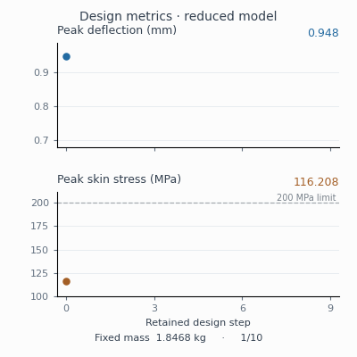
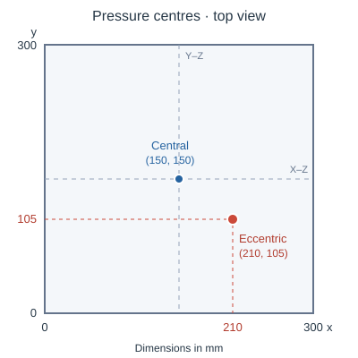

# Sandwich plate under pressure pulses

The response animations show complete 2 ms independent MPM trajectories,
with actual deformation and a common 0–1 mm back-face displacement scale.

## Uniform material distribution

<table width="100%">
<tr>
<td width="33%" align="center"><br>Uniform pressure</td>
<td width="33%" align="center"><br>Central pressure</td>
<td width="33%" align="center"><br>Eccentric pressure</td>
</tr>
</table>

The back-face peaks are 0.566446, 0.947616 and 0.889399 mm, respectively.
The frozen reduced model's maximum curve errors are 0.460%, 0.635% and
3.730%, below the unchanged 5% response criterion.
[Three-load response record](../evidence/blast-sandwich-reduced/union130-completed-initial-responses.json).

## Fixed-mass redistribution under eccentric pressure

<table width="100%">
<tr>
<td width="50%" align="center"><br>Initial distribution</td>
<td width="50%" align="center"><br>Round-one redistribution</td>
</tr>
</table>

At the same 1.8468 kg mass, redistribution reduces the peak from 0.889399 to
0.814771 mm (8.39%). Peak skin stress rises from 119.271 to 154.968 MPa,
below the prescribed 200 MPa limit.
[Matched independent comparison](../evidence/blast-sandwich-reduced/fullmpm-eccentric-comparison.json).

This comparison uses the earlier round-one design at 10 mm in-plane and
1 mm through-thickness spacing. Newer optimization candidates have separate
three-load verification runs; 5 mm refinement is also running. The model uses
elastic skins and an effective elastic core, without face plasticity or core
crushing. See the [problem definition](BLAST_SANDWICH_DESIGN.md) and
[media provenance](../evidence/blast-sandwich-reduced/fullmpm-completed-media.json).

## Central-load material optimization


<table width="100%"><tr>
<td width="50%"></td>
<td width="50%"></td>
</tr></table>

This discrete two-state sequence shows the actual saved uniform baseline and
best-so-far controls from a short, central-load-only fixed-mass reduced-model
search. Both designs have 1.8468 kg total mass. The candidate is exploratory:
it has not passed full-MPM verification, three-load qualification, or
independent optimum verification. The images show material fields, not motion.
[GIF and source provenance](images/sandwich-fullmpm/central-material-optimization.json).
The side views show the full span above and an enlarged central section below;
grey layers are the 2 mm skins. [Section provenance](images/sandwich-fullmpm/central-sections.json).

Reproduce the fields and ParaView render from the saved control snapshot:

```sh
python -m tools.export_sandwich_design_history evidence/blast-sandwich-reduced/central-material-controls.npz outputs/central-material-fields
pvpython --force-offscreen-rendering tools/render_sandwich_design_history.py outputs/central-material-fields outputs/central-material-render
```

## Material redistribution

<table width="100%">
<tr>
<td width="50%" align="center"></td>
<td width="50%" align="center"></td>
</tr>
</table>

Ten retained designs through round six, at a constant 1.8468 kg mass.
Blue to red represents core solid fraction from 0.08 to 0.35; the skins are
hidden to expose the core. These are discrete design states, not a deformation
animation. Full-MPM verification of the newer candidates is ongoing.
The independently reserved 13-frame window for candidate `94934d1d` failed
qualification under uniform and central pressure. Maximum point-response
error was 8.03% under uniform pressure; maximum omitted linear strain energy
was 16.13% and 9.75%, respectively, above the unchanged 5% limits.
Eccentric pressure passed this window. These results concern the newer
candidate, not the completed round-one comparison above. Further optimization
on this reduced basis is on hold while the basis is extended using the
candidate's physical operators. The plotted reduced-model improvements are
predictions, not independently verified benefits.
[Original three-load reports](../evidence/blast-sandwich-reduced/q94934-threecase-fresh-v2.json).
The adjacent plots use the same design order and frame durations. They show
the largest sampled back-face deflection and skin stress across all three
loads in the frozen reduced model. The dashed line is the 200 MPa skin-stress
limit. [Metric data and provenance](../evidence/blast-sandwich-reduced/material-design-history/rom-metrics.json).

The [control snapshots](../evidence/blast-sandwich-reduced/material-design-history/controls.npz)
and their [provenance](../evidence/blast-sandwich-reduced/material-design-history/controls.json)
reproduce the fields without rerunning optimization:

```sh
python -m tools.export_sandwich_design_history evidence/blast-sandwich-reduced/material-design-history/controls.npz outputs/sandwich-design-fields
pvpython --force-offscreen-rendering tools/render_sandwich_design_history.py outputs/sandwich-design-fields outputs/sandwich-design-render
python -m tools.render_sandwich_design_metrics evidence/blast-sandwich-reduced/material-design-history/rom-metrics.json outputs/sandwich-design-metrics
```

The metric renderer uses Matplotlib, included in `pip install -e ".[design]"`.

## Pressure centres



On the 300 × 300 mm plate, the central and eccentric Gaussian pressure centres
are (150, 150) and (210, 105) mm. Both have a 60 mm standard deviation in each
in-plane direction. The uniform case loads the entire face. These are prescribed
surface-pressure footprints; no explosive charge or stand-off distance is modelled.
The top-view orientation matches the material distribution GIF. Grey dashed
lines locate the two central sections below.

## Through-thickness material sections

<table width="100%">
<tr>
<td width="50%" align="center"><br>X–Z section</td>
<td width="50%" align="center"><br>Y–Z section</td>
</tr>
</table>

Each image shows the full 300 mm span above and a 92 mm central crop below,
with the same magnification in the horizontal and thickness directions.
Grey layers are the actual 2 mm skins. Colours show core solid fraction,
using the same 0.08–0.35 scale as the plan view.
[Section provenance](../evidence/blast-sandwich-reduced/material-design-history/sections-render.json).

The three-load objective includes a pressure footprint centred at
(210, 105) mm, offset from the plate centre (150, 150) mm. Consequently,
the loading set is not reflection-symmetric and the material controls are
not constrained to be symmetric. This explains why symmetry is not required;
it does not replace the independent response checks.

```sh
pvpython --force-offscreen-rendering tools/render_sandwich_design_sections.py outputs/sandwich-design-fields outputs/sandwich-design-sections
```

## Internal-force execution

`mpm_jax.blocked_elastic.make_internal_force(reference, material)` provides
the same Neo-Hookean internal-force calculation in 4096-point blocks.
It retains the original supports and contribution order while bounding the
temporary force array. The caller remains responsible for external loads,
time integration and physical checks.

On an actual 691200-point state, the force kernel was 1.255 times faster and
matched the original force bitwise. A separate 20-step trajectory comparison,
timed in both execution orders after warm-up, measured 1.164 times the speed.
Displacement differences were at most 5.42e-20 m; accumulated work, impulses
and peak statistics matched bitwise. This is a short execution-equivalence
check, not a completed refinement result. The [performance record](../evidence/blast-sandwich-reduced/h5-blocked-force-performance.json)
also retains the slower reverse-gather alternative that was rejected.

The two 5 mm production trajectories have since continued from step 10000
with the blocked driver. Their first resumed step matched the original
integrator bitwise in every state field, with all earlier history rows
preserved. Earlier visualization frames remain unchanged in the continued
trajectory. Both computations retain the full 2 ms schedule and are still
in progress. [Paired execution handoff](../evidence/blast-sandwich-reduced/h5-blocked-handoff/summary.json).

The `prebound` backend prepares fixed support arrays once, before JIT tracing.
The first public `blocked` wrapper prepared them inside the traced step and
did not reproduce the earlier benchmark's speed benefit. A matched 24-step,
reversed-order comparison measured `prebound` at 1.204 times that wrapper's
speed and 1.182 times the original integrator's speed. Compiled temporary
storage fell from 1.047 GB to 0.587 GB, with equivalent state and ledgers.
Both production trajectories have now explicitly continued with this setup,
from steps12000 and13000; their first resumed states matched the original
integrator bitwise. Full-duration timing remains in progress.
[Setup comparison and handoff records](../evidence/blast-sandwich-reduced/h5-prebound/).

The standalone driver keeps the original time integrator and every history,
energy and validity check. It adds a separate execution binding, so a changed
backend or kernel cannot silently resume an existing checkpoint:

```sh
python -m tools.run_sandwich_fullmpm examples/sandwich_fullmpm_prebound.json
python -m tools.run_sandwich_fullmpm examples/sandwich_fullmpm_prebound.json --resume
```

The recipe starts the round7 minimum-peak candidate from rest on the 5 mm
in-plane grid for the complete 2 ms eccentric-pressure history. It is a
production recipe, not a claim that this candidate's run has completed.
Use four CPU threads and budget at least 16 GB for the process. To stop at
an absolute checkpoint boundary, pass `--stop-step N`, then continue with
`--resume`; this does not shorten or rescale the physical loading schedule.

An unchanged legacy trajectory can be imported explicitly with
`--import-checkpoint path/to/checkpoint.npz` and a matching control, geometry,
runtime and load configuration. The driver preserves all saved state and
history and records the original checkpoint hash. Preserve the parent
trajectory's earlier frames for complete rendering. A changed control field
requires a virgin run, not checkpoint import.
For a checkpoint that already has an execution binding, also supply
`--import-execution-receipt path/to/execution.json`. The driver checks its
physical sources, runtime, controls, load case and old execution binding,
then records both parent hashes. Ordinary `--resume` still rejects changed
execution inputs.
The [actual-state round-trip check](../evidence/blast-sandwich-reduced/h5-blocked-public-driver.json)
imported a real h5 step8000 checkpoint, advanced one step, resumed one further
step, and compared both with the original integrator. Earlier history rows
were preserved bitwise, and incompatible execution settings were rejected.

